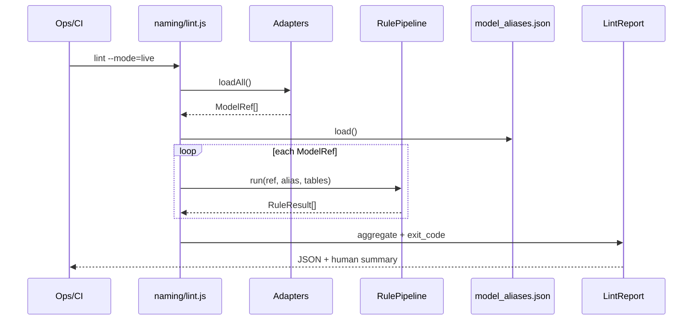
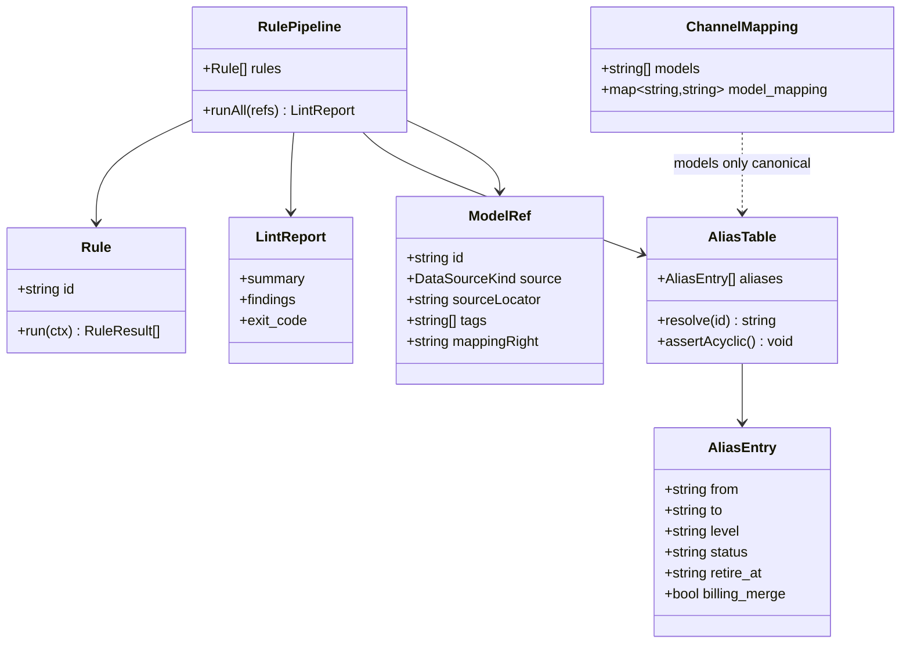
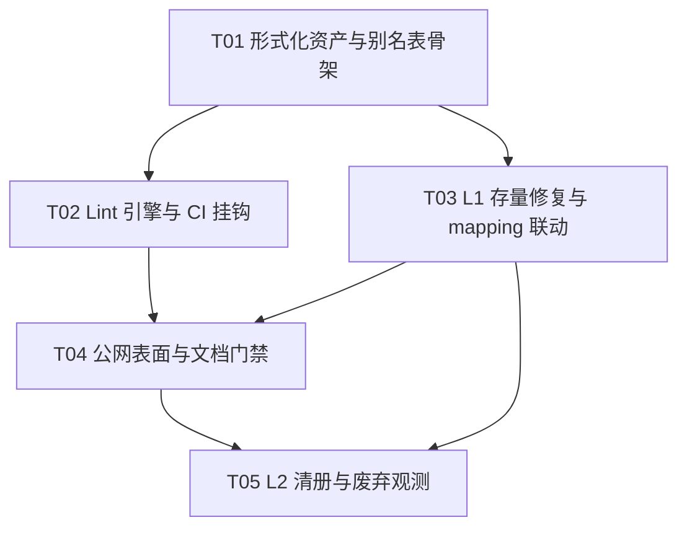

# OmniMux 模型命名规范 — 系统架构设计规格书

| 字段 | 内容 |
| --- | --- |
| 文档版本 | v1.0 |
| 状态 | Ready for Implementation |
| 架构师 | 高见远（Gao） |
| 上游 PRD | `docs/product/omnimux-model-naming-convention-prd-zh.md`（许清楚 / Xu） |
| 创建日期 | 2026-08-30 |
| 语言 | 中文 |
| 落地形态 | **Ops-first**：规范形式化 + Lint 引擎（Node，挂 pricing-ledger / CI）+ Alias 映射表 + Channel `model_mapping` 联动；**本迭代不改** `controller/` `relay/` 等受保护核心路径（除非运营签字后单独开 Core-Change） |

---

## 0. 架构裁决摘要（对 PRD Open Questions 拍板）

| # | 议题 | 裁决 | 理由 |
| --- | --- | --- | --- |
| Q1 | Alias 落点 | **独立 `model_aliases.json`（权威）+ 运行时解析层优先读别名表**；渠道 `model_mapping` **左侧只保留 canonical**。过渡期允许 mapping 左侧临时挂旧名，但必须由 alias 表登记且计费键强制归并到 canonical。 | 避免「每个渠道各自发明别名」导致双计与 failover 漂移；独立表可驱动定价页 `deprecated` 字段与废弃时间表。 |
| Q2 | `gpt-image2` 切断日 | **T0+30 天默认切断**；需运营在 Multica / 变更单签字确认流量基线。架构侧按 30 天窗口设计，延期只允许一次 +30。 | 与 PRD §5.5 一致。 |
| Q3 | `veo-3.1` | **定为点号例外（Text/官方视频通行 ID 白名单）**；`veo_3_1` → alias → `veo-3.1`。 | 对齐 Google / 聚合商习惯；不强制改成 `veo-3-1`。 |
| Q4 | Seedance 分辨率/时长 | **默认单 ID + 阶梯表达式 / 请求参数**；仅当价差无法参数化且必须一档一价时，才升格为符合 Core Rules 的后缀 ID（如 `-720p` / `-30s`）。L2 长尾不对公网主推。 | 防止目录爆炸。 |
| Q5 | nano-banana 展示文案 | **ID 保持 `nano-banana-*`**；description / UI Title 可写「Gemini 图像能力」真相。不在本迭代改 ID 品牌。 | ID 稳定优先于营销正名。 |

**架构原则：**

1. **Public ID 是产品边界**，上游 SKU 是 Anti-Corruption 内侧。
2. **Lint 是门禁，Mapping 是解耦，Alias 是迁移**——三者职责分离，禁止互相替代。
3. **计费唯一键 = canonical public ID**；alias 请求必须在入账前归一。
4. **本迭代优先 config/ops**（ledger、scripts、docs、skill）；核心 Go 路径变更需二次确认。

---

## 1. 命名形式化语法

### 1.1 EBNF（Canonical Public Model ID）

```ebnf
(* OmniMux Public Model ID — media-strict + text-exception *)

letter          = "a" | "b" | … | "z" ;
digit           = "0" | "1" | … | "9" ;
alnum           = letter | digit ;
token           = alnum, { alnum } ;                 (* 无空、无下划线 *)

(* 媒体产品：仅连字符分词，禁止点号 *)
media_id        = token, { "-", token } ;

(* 文本 / 官方通行：允许 '.' 作为版本小数分隔 *)
text_id         = token, { ( "-" | "." ), token } ;

(* 顶层：默认按媒体严格式；若含 '.' 则必须命中官方例外族 *)
public_model_id = media_id
                | text_exception_id ;

text_exception_id = text_id ;
(* 语义约束：text_exception_id 的 family 前缀 ∈ OfficialDotAllowlist *)

(* 推荐结构段（非强制捕获组，供解析器/推荐器用） *)
structured      = family, [ "-", version ], [ "-", variant ], [ "-", tier ] ;
family          = token, { "-", token } ;            (* 如 gpt-image, nano-banana, seedance, kling *)
version         = "v", digit, { digit | "-", digit }
                | digit, { digit }, [ "-", digit, { digit } ] ;
variant         = "fast" | "mini" | "pro" | "motion-control" | token ;
tier            = "hd"
                | digit, { digit }, "s"             (* 4s / 6s / 10s *)
                | digit, { digit }, "p" ;           (* 720p — 仅一档一价例外 *)
```

**语义附加约束（不单靠 EBNF）：**

| ID | 约束 |
| --- | --- |
| S1 | 全串小写；禁止首尾 `-`；禁止 `--` |
| S2 | 含 `.` ⇒ family 必须匹配 OfficialDotAllowlist |
| S3 | 媒体新产品（Image/Video/Audio 任务型上架）⇒ 不得含 `.` |
| S4 | 禁止命中 ForbiddenFragment 表（供应商前缀、协议后缀、运维垃圾） |
| S5 | `{family}-{version}-{variant}-{tier}` 段数建议 ≤ 6；超长 L2 不得主推 |

### 1.2 正则定义

```text
# R1 — 新媒体 / 严格 canonical（无点号）
STRICT_ID = ^[a-z0-9]+(?:-[a-z0-9]+)*$

# R2 — 文本/官方例外（允许点号）
DOT_ALLOWED_ID = ^[a-z0-9]+(?:[.-][a-z0-9]+)*$

# R3 — 官方点号族（白名单前缀；命中后才允许 R2）
OFFICIAL_DOT_FAMILY = ^(gpt|gemini|claude|veo|sd3\.5|o[1-9]|chatgpt|tts|whisper)(-|$)

# R4 — 媒体产品族（强制走 R1，禁止点号版本）
MEDIA_FAMILY = ^(seedance|kling|gpt-image|nano-banana|flux|omni-flash|wan|hailuo|minimax-video|midjourney|suno)(-|$)

# R5 — 形态损坏快速否决
HAS_UNDERSCORE     = _
HAS_UPPERCASE      = [A-Z]
HAS_WHITESPACE     = \s
HAS_NON_ASCII      = [^\x00-\x7F]
HAS_DOUBLE_HYPHEN  = --
HAS_EDGE_HYPHEN    = ^-|-$
HAS_PATH_CHARS     = [/:]
GLUED_VERSION      = [a-z]{2,}[0-9]+\.[0-9]+   # seedance2.0…
MISSING_TOKEN_SPLIT= ^(gpt-image|nano-banana)[0-9]  # gpt-image2
```

**判定伪代码：**

```text
function classify(id):
  if empty(id): return REJECT(EMPTY)
  if HAS_UNDERSCORE|HAS_UPPERCASE|HAS_WHITESPACE|HAS_NON_ASCII|HAS_PATH_CHARS|HAS_DOUBLE_HYPHEN|HAS_EDGE_HYPHEN:
      return REJECT(CHARSET)
  if id matches MEDIA_FAMILY and id contains '.':
      return REJECT(MEDIA_DOT_VERSION)
  if id matches GLUED_VERSION or MISSING_TOKEN_SPLIT:
      return REJECT(TOKENIZATION)
  if id contains '.':
      if id matches DOT_ALLOWED_ID and id matches OFFICIAL_DOT_FAMILY:
          return PASS_TEXT_EXCEPTION
      return REJECT(DOT_NOT_ALLOWLISTED)
  if id matches STRICT_ID:
      return PASS_STRICT
  return REJECT(SHAPE)
```

### 1.3 黑名单负向检测（Forbidden Fragments）

按「命中即 FAIL」扫描（大小写不敏感；匹配前先 `toLowerCase`）：

| 类别 | 片段（示例，可配置扩展） | Severity |
| --- | --- | --- |
| 供应商/渠道站名 | `apimart-`, `goeasy-`, `runninghub-`, `rh-`, `weijin-`, `evolink-`, `tokens-`, `gxgen-` | error |
| 上游云前缀（非客户品牌） | `doubao-`（当作为 public 前缀） | error |
| 协议层 | `-async`, `-sync`, `-query`, `task-query` | error |
| 运维垃圾 | 8+ hex hash 尾巴、`xuan-`, `zijian`, `svip`, `413-mini`, 中文 | error |
| 不推荐分辨率堆砌 | `stable-full`, `stable-max`, `facefree` | warn（L2） |
| 旧错误拼写整词 | `nano_banana_`, `gpt-image2`, `omni_flash`, `veo_3_1`, `seedance2.` | error（存量扫描） |

配置源：`scripts/ops/pricing-ledger/naming/forbidden-fragments.json`（建议新建）。

### 1.4 OfficialDotAllowlist（初始）

```json
{
  "families": [
    "gpt", "gemini", "claude", "veo", "sd3.5",
    "o1", "o3", "o4", "chatgpt", "tts", "whisper"
  ],
  "notes": "媒体新产品禁止加入；wan-3.0* 灰色地带：存量可保留，新媒体名建议 wan-3-0*"
}
```

---

## 2. 命名校验引擎架构设计

### 2.1 定位与边界

```text
┌─────────────────────────────────────────────────────────────────┐
│  Data Sources（只读采集）                                         │
│  · NewAPI Admin /api/models · Channel.models · ModelPrice keys  │
│  · pricing-ledger/models/*.json · outputs/prod_models.json      │
│  · GET /api/pricing（公开列表）                                    │
└────────────────────────────┬────────────────────────────────────┘
                             │ Adapter
                             ▼
┌─────────────────────────────────────────────────────────────────┐
│  Naming Lint Engine（Node，挂 scripts/ops/pricing-ledger）        │
│  Parser → Rule Pipeline → Report Aggregator → Exit Code          │
└────────────────────────────┬────────────────────────────────────┘
                             │
          ┌──────────────────┼──────────────────┐
          ▼                  ▼                  ▼
   CI check-pr.js      本地 ops CLI        Multica 告警
   （阻断新违规）      （存量分级报告）      （可选）
```

**不做的事：** 本迭代不在 Gin 热路径做实时拒绝（避免 Core-Change）；网关侧依赖 ops 门禁 + alias 归一。若未来要做请求期 410，单开 Core-Change。

### 2.2 模块设计

| 模块 | 路径（建议） | 职责 |
| --- | --- | --- |
| `charset` | `naming/rules/charset.js` | R1/R2 形状与字符集 |
| `token-split` | `naming/rules/token-split.js` | 粘连版本、`gpt-image2` 类缺分词 |
| `dot-allowlist` | `naming/rules/dot-allowlist.js` | 点号例外白名单 |
| `forbidden` | `naming/rules/forbidden.js` | 负向片段表 |
| `modality-policy` | `naming/rules/modality-policy.js` | 媒体强制 STRICT；文本允许 DOT |
| `alias-consistency` | `naming/rules/alias-consistency.js` | alias→canonical 闭环、无环、到期 |
| `ledger-align` | `naming/rules/ledger-align.js` | ledger `public_id` ↔ ModelPrice ↔ channel models |
| `pipeline` | `naming/pipeline.js` | 有序执行 Rule、短路策略 |
| `adapters/*` | `naming/adapters/*.js` | 多数据源 → 统一 `ModelRef[]` |
| `cli` | `naming/lint.js` | CLI 入口；供 `check-pr.js` / audit 调用 |
| `schema` | `naming/schema.json` | 报告与 alias 表 JSON Schema |

### 2.3 Rule 管道设计

```text
ModelRef
  → R01 CharsetShape          (error, short-circuit)
  → R02 Tokenization          (error)
  → R03 MediaDotBan           (error if media + '.')
  → R04 DotAllowlist          (error if '.' and not allowlisted)
  → R05 ForbiddenFragments    (error|warn by fragment severity)
  → R06 ProtocolSuffixBan     (error: -async/-sync/-query)
  → R07 VendorPrefixBan       (error)
  → R08 AliasGraph            (error: dangling / cycle / expired without retire)
  → R09 LedgerPriceAlign      (error on CI live: CHANNEL_MAPPING_DRIFT 扩展)
  → R10 PublicPricingSurface  (warn/error: 默认列表不得出现 L1/L2 未标记名)
```

**Rule 接口：**

```ts
interface RuleContext {
  ref: ModelRef;
  aliases: AliasTable;
  allowlist: DotAllowlist;
  forbidden: ForbiddenTable;
  modalityHint?: 'text' | 'image' | 'video' | 'audio' | 'unknown';
  source: DataSourceKind;
}

interface RuleResult {
  ruleId: string;
  severity: 'error' | 'warn' | 'info';
  code: string;           // e.g. MEDIA_DOT_VERSION
  message: string;
  suggest?: string;       // canonical 建议
}

interface Rule {
  id: string;
  run(ctx: RuleContext): RuleResult[];
}
```

**短路：** `error` 且 `rule.fatal === true`（R01）时跳过后续昂贵规则；其余规则尽量跑完以便一次修多项。

### 2.4 核心数据结构

```ts
/** 统一模型引用（多源归一） */
interface ModelRef {
  id: string;                    // 待校验的 public 或疑似 public
  source: DataSourceKind;
  sourceLocator: string;         // file:line / channel_id / api path
  tags?: string[];               // 模态 tag
  vendorId?: number;
  priceKeys?: string[];          // ModelPrice / ledger
  mappingRight?: string;         // upstream SKU if known
  levelHint?: 'L0' | 'L1' | 'L2' | 'L3';
}

type DataSourceKind =
  | 'ledger'
  | 'channel_models'
  | 'model_meta'
  | 'model_price'
  | 'public_pricing'
  | 'prod_snapshot'
  | 'alias_table';

interface AliasEntry {
  from: string;                  // 旧 public / 违规名
  to: string;                    // canonical
  level: 'L1' | 'L2' | 'L3';
  status: 'active' | 'warn' | 'retired';
  since: string;                 // ISO8601
  retire_at: string;             // ISO8601
  billing_merge: true;           // 硬约束：必须 true
  notes?: string;
}

interface LintReport {
  schema_version: 1;
  generated_at: string;
  summary: { error: number; warn: number; info: number; scanned: number };
  findings: Array<RuleResult & { ref: ModelRef }>;
  exit_code: 0 | 1 | 2;          // 0 ok / 1 warn-only(可选) / 2 error
}
```

### 2.5 多数据源接入

| Adapter | 输入 | 产出 ModelRef 要点 |
| --- | --- | --- |
| `ledgerAdapter` | `scripts/ops/pricing-ledger/models/*.json` | `public_id` + supplier |
| `channelAdapter` | Admin API / 导出的 channels：`models[]` + `model_mapping` | 左侧必须为 public；右侧记 `mappingRight` |
| `metaAdapter` | `/api/models/` 或 `outputs/prod_models.json` | `model_name` + tags + vendor |
| `priceAdapter` | Option / ModelPrice map keys | 计费键 |
| `pricingApiAdapter` | `GET https://omnimux.ai/api/pricing` | 公网默认可见集合 |
| `aliasAdapter` | `naming/model_aliases.json` | 校验图与到期 |

**Anti-Corruption：** Adapter 只做字段投影，不在 Adapter 内做命名裁决；裁决全集中在 Rule Pipeline。

### 2.6 与 pricing-ledger CI 集成

扩展 `policy.json`：

```json
"ci": {
  "fail_on": ["…", "NAMING_LINT_ERROR", "ALIAS_BILLING_SPLIT"],
  "warn_on": ["…", "NAMING_LINT_WARN", "L2_PUBLIC_SURFACE"],
  "live_fail_on": ["…", "CHANNEL_MAPPING_DRIFT", "DEPRECATED_ON_DEFAULT_PRICING"]
}
```

`check-pr.js` / `audit.js` 调用 `naming/lint.js --mode=pr|live`。

### 2.7 调用流（存量审计）



---

## 3. 存量修复与映射设计

### 3.1 分层职责

```text
客户请求 model
    │
    ▼
┌───────────────────┐
│ Alias Resolver    │  from → to（计费/统计用 to）
│ model_aliases.json│
└─────────┬─────────┘
          │ canonical
          ▼
┌───────────────────┐
│ Channel.models    │  仅列 canonical
│ + model_mapping   │  canonical → upstream SKU
└─────────┬─────────┘
          │
          ▼
┌───────────────────┐
│ Adaptor 特化映射   │  例：APIMart mapUpstreamModel
│ （可选二次翻译）   │
└───────────────────┘
```

### 3.2 Alias 策略

**权威文件：** `scripts/ops/pricing-ledger/naming/model_aliases.json`

```json
{
  "schema_version": 1,
  "policy": {
    "default_window_days": 30,
    "max_extension_days": 30,
    "billing_merge_required": true
  },
  "aliases": [
    {
      "from": "nano_banana_2",
      "to": "nano-banana-2",
      "level": "L1",
      "status": "active",
      "since": "2026-08-30",
      "retire_at": "2026-09-29",
      "billing_merge": true,
      "notes": "underscore → hyphen"
    },
    {
      "from": "nano_banana_pro",
      "to": "nano-banana-pro",
      "level": "L1",
      "status": "active",
      "since": "2026-08-30",
      "retire_at": "2026-09-29",
      "billing_merge": true
    },
    {
      "from": "gpt-image2",
      "to": "gpt-image-2",
      "level": "L1",
      "status": "active",
      "since": "2026-08-30",
      "retire_at": "2026-09-29",
      "billing_merge": true
    },
    {
      "from": "gpt-image2-hd",
      "to": "gpt-image-2-hd",
      "level": "L1",
      "status": "active",
      "since": "2026-08-30",
      "retire_at": "2026-09-29",
      "billing_merge": true
    },
    {
      "from": "veo_3_1",
      "to": "veo-3.1",
      "level": "L1",
      "status": "active",
      "since": "2026-08-30",
      "retire_at": "2026-09-29",
      "billing_merge": true,
      "notes": "Google-style dot exception"
    }
  ]
}
```

**不变式：**

1. `billing_merge` 必须为 `true`；禁止 alias 独立占 ModelPrice 且与 canonical 不同价不归并。
2. 图无环；`to` 必须是 L0 canonical（或过渡期临时 L0）。
3. `status=retired` 后：公网请求应返回明确迁移错误（若未做网关改动，则至少从 channels/models/pricing 移除旧键）。
4. 双写期：ModelPrice 可短暂双键，但报表与 ledger `public_id` 以 `to` 为准；audit 检测「双键不同价」为 `ALIAS_BILLING_SPLIT`。

**时间线（与 PRD 对齐）：**

| 阶段 | 动作 |
| --- | --- |
| T0 | 规范发布；lint 强制新上架；alias 表生效；文档/skill 改 canonical |
| T0–T14 | 双轨兼容；定价页默认只展示 canonical；旧名可搜到并标 Renamed |
| T14–T30 | warn 期：用量标 deprecated；docs banner |
| T30+ | 默认移除旧键；高流量可申请一次 +30 天 |

### 3.3 NewAPI DB 与 Channel `model_mapping` 联动

| 表面 | 规则 |
| --- | --- |
| `channels.models` | **只列 canonical**；旧名不进列表（alias 在解析层处理，或过渡期左侧临时双挂但必须登记 alias） |
| `channels.model_mapping` | JSON map：`{ "canonical": "upstream-sku" }`；**右侧**可含 `-async`、`doubao-` 等 |
| Model meta `model_name` | canonical；旧 meta 到期删除 |
| ModelPrice / ModelRatio key | canonical；双写窗口内旧键指向同价或只读归并 |
| APIMart `mapUpstreamModel` | 保持 public→上游二次翻译（已有 seedance）；**不**承担客户旧名兼容 |
| GoEasy 等 | mapping 左侧改为 `gpt-image-2`；右侧保留 `gpt-image-2-async` |

**联动作业流（人工 + 脚本，无 Core-Change）：**

```text
1. 写 alias 表 + ledger public_id 修正
2. newapi skill：PUT model meta 改名 / 新建 canonical
3. 更新各渠道 models[] 与 model_mapping 左侧
4. ModelPrice 双写 → 验证计费 → 删旧键（到期）
5. 公开定价页缓存失效 / 确认默认列表无旧名
6. OmniMux-docs 示例同步（docs gate）
7. lint --mode=live 全绿
```

### 3.4 L2 长尾（weijin 等）

- 渠道内侧保留 upstream 原名于 mapping **右侧**或供应商专用渠道。
- **不**进入公网 `models` 主列表与定价默认列表。
- 能归并则 alias/归并到 `seedance-2-*`；不能则限制可见分组或下架。
- Lint：`L2_PUBLIC_SURFACE` 若在 `/api/pricing` 默认集发现粘连名/hash/中文 → fail live。

### 3.5 类图（概念）



---

## 4. 任务分解清单

> 硬限制：≤ 5 个任务；按功能模块分组；T01 为基础设施。  
> 责任人按团队角色；本迭代以 **Ops / Agent 文档 / ledger 脚本** 为主，避免默认改受保护 Go 路径。

### 4.1 Required Packages / 工具

```text
- 现有 Node（pricing-ledger 同运行时）：无强制新依赖；必要时 ajv 做 JSON Schema（若仓库已有则复用）
- newapi skill：生产 meta / channel 变更
- Multica：运营签字与巡检单（可选）
```

### 4.2 任务列表

| Task ID | 任务名称 | 责任人 | 输入 | 输出文件 | 依赖 | 优先级 | 顺序 |
| --- | --- | --- | --- | --- | --- | --- | --- |
| **T01** | 命名规范基础设施与形式化资产 | 高见远 / 工程师寇豆码 | PRD；本架构书；现有 `model-naming.md` | `scripts/ops/pricing-ledger/naming/` 目录骨架：`schema.json`、`forbidden-fragments.json`、`official-dot-allowlist.json`、`model_aliases.json`（初值含 L1 表）；同步修订 `.agents/skills/newapi/docs/model-naming.md` 冲突示例；本文件 `docs/architecture/omnimux-model-naming-convention-architecture-zh.md` | — | P0 | 1 |
| **T02** | 校验引擎 Rule 管道 + 多源 Adapter + CLI | 寇豆码（Engineer） | T01 资产；ledger `lib/common.js`；`policy.json` | `naming/pipeline.js`、`naming/rules/*.js`、`naming/adapters/*.js`、`naming/lint.js`、单测 `naming/__tests__/`；`policy.json` 增加 `NAMING_*` fail/warn；`check-pr.js` / `audit.js` 挂钩 | T01 | P0 | 2 |
| **T03** | 存量 L1 修复作业包（Alias + DB/渠道 mapping 联动剧本） | 运维 + 寇豆码（newapi skill） | T01 alias 表；生产快照；渠道清单 | 可执行 runbook：`docs/ops/model-naming-migration-zh.md`；实际变更：canonical meta、channels models/mapping、ModelPrice 双写；ledger `models/*.json` 中 `nano_banana_*` 等改 canonical；APIMart 映射回归确认 | T01 | P0 | 3（可与 T02 并行启动准备，落地变更建议 T02 lint 可跑后执行） |
| **T04** | 公网表面收敛与文档门禁 | 许清楚协调 / Docs + 前端定价若需 | T03 变更后的 live 目录 | 定价页默认列表仅 L0；OmniMux-docs 示例改 canonical；Agent checklist；`DEPRECATED_ON_DEFAULT_PRICING` live 检查绿灯 | T02, T03 | P0 | 4 |
| **T05** | L2 长尾清册与废弃观测（含切断日告警） | 运维 + QA 沈测全 | weijin 等导出；alias `retire_at` | L2 清册 CSV/JSON；分组限制或下架记录；T14/T30 观测清单与 QA 验收用例；P1 自动推荐器仅开 issue 不实现 | T03, T04 | P1 | 5 |

### 4.3 任务依赖图



### 4.4 Shared Knowledge（工程师必读）

```text
- Public ID 字符集：媒体 STRICT ^[a-z0-9]+(?:-[a-z0-9]+)*$ ；点号仅 OfficialDotAllowlist
- 禁止：_、大写、空格、非 ASCII、供应商前缀、-async/-sync/-query、hash/中文尾巴
- 计费唯一键 = canonical；alias 必须 billing_merge
- channels.models 与 model_mapping 左侧 = canonical；右侧 = upstream SKU
- APIMart mapUpstreamModel 是二次翻译，不替代 alias 表
- 本迭代默认不改 controller/relay 等保护路径；请求期 410 属后续 Core-Change
- 变更公开名 = 破坏性变更：运营确认 + OmniMux-docs 同步
- FX / 结算公式不在本需求范围
- 验证：node naming/lint.js --mode=pr ；ledger check-pr ；live smoke GET /api/pricing
```

### 4.5 验收门禁（Definition of Done）

| 门禁 | 命令/证据 |
| --- | --- |
| 形式化资产存在 | `naming/*.json` + schema 校验通过 |
| 新 ID lint | `node scripts/ops/pricing-ledger/naming/lint.js --mode=pr` exit 0 |
| L1 映射 | alias 表含 PRD §5.3 核心行；生产请求旧名可归并或已登记窗口 |
| 渠道 | 抽检 GoEasy/APIMart：`models` 无 `gpt-image2` / `nano_banana_*` 作主推 |
| 定价表面 | `/api/pricing` 默认列表无 L2 粘连名、无未标记 deprecated 旧名 |
| 文档 | `model-naming.md` 与 PRD 一致；docs 示例为 canonical |
| 回归 | APIMart `mapUpstreamModel` 单测仍绿；`go test` / ledger audit 无新增 NAMING error |

### 4.6 风险与回滚

| 风险 | 缓解 |
| --- | --- |
| 旧名切断导致客户失败 | 30 天 alias；高流量延期一次；错误体带 canonical |
| 双键不同价双计 | `ALIAS_BILLING_SPLIT` 强制 fail；双写必须同价 |
| 误改保护路径 | 作业限制在 admin API / ledger / docs；Core-Change 另批 |
| L2 误升格污染目录 | Lint `L2_PUBLIC_SURFACE` + 定价默认过滤 |

---

## 5. Anything UNCLEAR / 假设

1. **请求期 Alias 解析**：假设 T0–T30 优先用「渠道左侧临时双挂 + 价格双写」满足兼容，而不改 Gin；若运营要求响应头 `Warning` / 410 正文，需另开 Core-Change 任务。
2. **`wan-3.0*`**：假设本迭代冻结新媒体点号样式，存量不强制迁；专项裁决可在 T05 输出建议。
3. **`omni_flash*`**：若生产仍在用，按 L1 纳入 alias；若已下线则标 L3 retired。
4. **自动 SKU→public 推荐器**：明确为 P2，不在 T01–T05 实现代码，仅在 T05 留 issue。

---

## 6. 决策摘要（执行口径）

| 议题 | 决策 |
| --- | --- |
| 语法 | EBNF + STRICT/DOT 双正则 + 黑名单负向检测 |
| 引擎 | pricing-ledger 下 Node Rule 管道；多 Adapter；CI fail on `NAMING_LINT_ERROR` |
| Alias | 独立 `model_aliases.json` 权威；计费归并 canonical |
| Mapping | Channel 左侧 canonical；右侧 upstream；Adaptor 二次翻译可选 |
| 存量 | L1 30 天窗口；L2 不对公网；L3 删除 |
| 任务 | T01→T02/T03→T04→T05，最多 5 项 |

---

*本规格书响应 PRD v1.0；若 PRD 修订 Open Questions，以本文 §0 裁决为技术基线，变更走 ADR 追加。*
