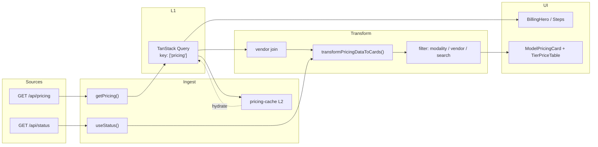
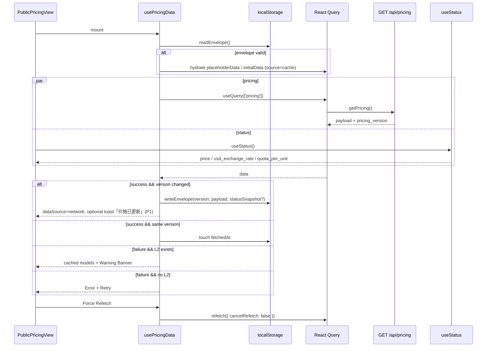
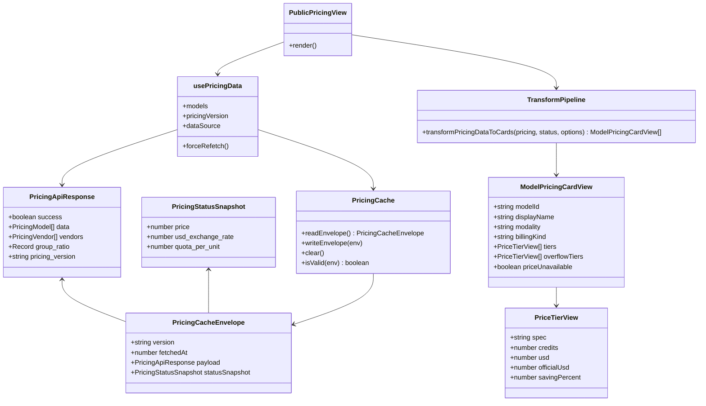
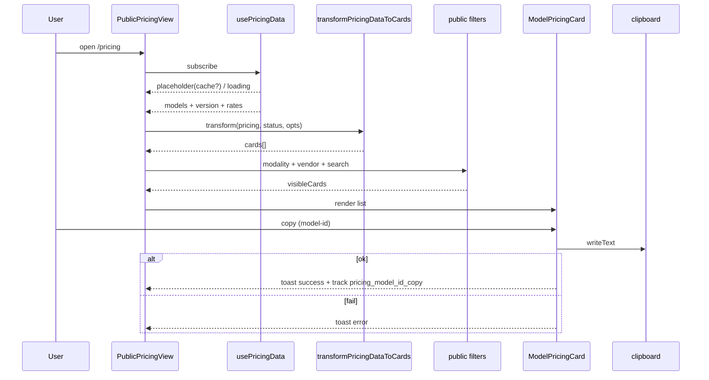
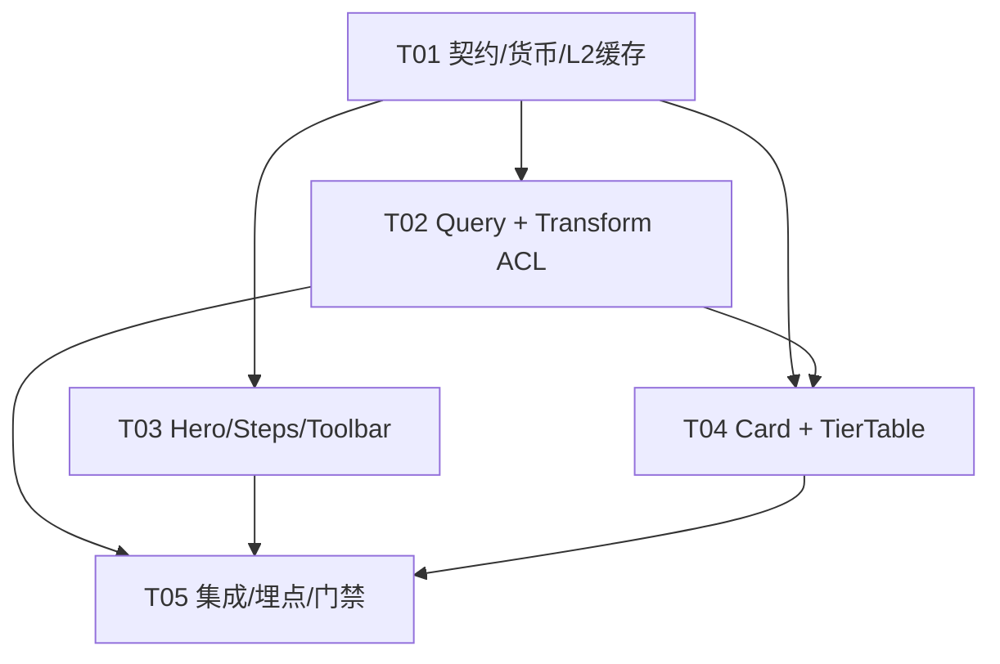

# OmniMux 实时价格页面 — 系统架构设计与工程实施技术规格书

| 字段 | 内容 |
| --- | --- |
| 文档版本 | v1.0 |
| 状态 | Ready for Engineering |
| 架构师 | 高见远（Gao） |
| 上游输入 | `docs/product/omnimux-realtime-pricing-page-prd-zh.md`（许清楚 / PRD v1.0） |
| 目标工程 | OmniMux `web/src/features/pricing/**`（只读消费 `controller/pricing.go` / `model/pricing.go`） |
| 参考原型 | `outputs/apimart-pricing`（交互 / IA 参照；**禁止**整包暗色硬编码入生产） |
| 创建日期 | 2026-08-30 |
| 语言 | 中文（UI 文案走 i18n，键名以英文源文案为准） |

---

## 0. 执行摘要

本迭代将公网 Pricing Stage 从「控制台工具页 + Mock 原型」收敛为：

1. **真源驱动**：100% 消费 `GET /api/pricing` + `GET /api/status`，生产路径零 Mock。
2. **转化导向 UI**：Hero → 三步计费 → Toolbar → 极简模型卡 + 四列阶梯价表（对齐已验证原型 IA，样式映射 OmniMux Design Tokens）。
3. **多级缓存**：TanStack Query L1 + `localStorage` L2 + `pricing_version` bust + 5min 静默轮询 / Force Refetch。
4. **计费口径硬约束**：`raw_quota ÷ quota_per_unit(默认 500000) = USD`；**1 USD = 10 Credits**；禁止把 raw_quota 叫「积分」；禁止硬编码 FX。

**默认范围**：前端 feature 扩展与重构；**不改**后端结算公式；若需改 `controller/` / `model/` 行为须走 Core-Change 门禁。当前后端顶层 `pricing_version` 为常量 Hash——前端**兼容顶层字段优先**，后端内容哈希修正单独立项，不阻塞本迭代。

---

## 1. 实现路径与难点分析

### 1.1 核心技术挑战

| # | 难点 | 架构对策 |
| --- | --- | --- |
| C1 | 后端异构计费（token / per-request / `tiered_expr`）→ 统一四列卡片 | 纯函数 `transformPricingDataToCards` 作为 Anti-Corruption Layer；复用 `billing-expr.ts` / `dynamic-price.ts` / `price.ts` |
| C2 | Credits / USD / raw_quota / priceRate / FX 口径易混 | 单一货币模块 `lib/credits.ts`；展示层只读 USD→Credits；结算以后端为准 |
| C3 | 原型硬编码色 vs OmniMux token / 深浅色 | Token 映射表（§6）；组件只用 `bg-card` / `border-border` / `text-muted-foreground` / `text-primary` / `text-success` 等 |
| C4 | 存量页过滤器过载 vs 公网转化主路径 | **公网默认视图**新建 `PublicPricingView`；存量 sidebar/table/drawer 降为兼容层（P1），同 feature 共存、路由默认公网视图 |
| C5 | 缓存新鲜度与离线秒开 | L1+L2+version bust；失败有 L2 则 Warning Banner；无 L2 则 Error+Retry，绝不展示假价 |
| C6 | Official / Saving 数据源缺失 | P0 整列优雅降级 `—`，保留列宽；P1 再接官方价 map |

### 1.2 框架与库选型（沿用现网，不新增重量级依赖）

| 能力 | 选型 | 理由 |
| --- | --- | --- |
| UI | React 19 + Tailwind + Base UI/Shadcn + Lucide/Hugeicons | 与 `web/AGENTS.md` 一致 |
| 服务端状态 | TanStack Query（已有） | L1 缓存、去重、`refetchInterval`、Force Refetch |
| 持久缓存 | `localStorage` 自研 envelope | 轻量；与现有 `useStatus` 持久化模式对齐 |
| 路由壳 | 现有 `PublicLayout` + TanStack Router | 不自带 Navbar/Footer |
| 测试 | Vitest + Testing Library | 纯函数单测优先（换算 / 过滤 / 缓存 / transform） |
| i18n | i18next + `t('English key')` | 全站规范 |

### 1.3 架构模式

- **Feature Modular Monolith（前端）**：所有改动收敛在 `web/src/features/pricing/`。
- **ACL（Anti-Corruption Layer）**：`transformPricingDataToCards` 隔离后端 DTO 与公网卡片 ViewModel。
- **CQRS-lite（读侧）**：页面只读 pricing/status；无写路径进入结算。
- **Progressive Enhancement**：Hero/三步可静态首屏；模型区 Skeleton → 真数据 / 缓存降级。

---

## 2. 目标目录与文件清单

> 原则：扩展现有 feature，**不**平行第三套页面；原型仅作交互参照。

```
web/src/features/pricing/
├── index.tsx                          # 入口：默认渲染 PublicPricingView（P0）
├── api.ts                             # getPricing（保留）；可选 getPricingWithMeta
├── types.ts                           # 扩展 PricingData.pricing_version 等
├── constants.ts                       # + PRICING_REFETCH_MS / CACHE_KEY / CREDITS 常量入口
├── public-pricing-view.tsx            # 【新】公网主视图编排
├── components/
│   ├── billing-hero.tsx               # 【新】Hero + 4 胶囊 + 双 CTA
│   ├── billing-method-steps.tsx       # 【新】三步计费说明
│   ├── pricing-toolbar.tsx            # 【改】收敛为 Modality + Vendor + Search + Refresh
│   ├── modality-tabs.tsx              # 【改】P0 露出 ALL/IMAGE/VIDEO/LLM/AUDIO
│   ├── model-pricing-card.tsx         # 【新】极简 Header + 价表容器
│   ├── tier-price-table.tsx           # 【新】四列 SPEC/OUR/OFFICIAL/SAVING
│   ├── pricing-offline-banner.tsx     # 【新】缓存/错误 Banner
│   ├── empty-state.tsx                # 复用/微调
│   ├── loading-skeleton.tsx           # 复用/微调卡片脉冲
│   ├── model-card.tsx / model-card-grid.tsx / pricing-sidebar.tsx / ...  # 存量兼容（P1）
│   └── index.ts                       # 导出更新
├── hooks/
│   ├── use-pricing-data.ts            # 【改】version、refetchInterval、L2 hydrate、dataSource
│   ├── use-public-pricing-filters.ts  # 【新】公网精简过滤（modality/vendor/search）
│   ├── use-filters.ts                 # 存量保留
│   └── index.ts
├── lib/
│   ├── credits.ts                     # 【新】CREDITS_PER_USD / usdToCredits / format*
│   ├── pricing-cache.ts               # 【新】L2 envelope 读写 / version bust / 损坏兜底
│   ├── transform-pricing-cards.ts     # 【新】transformPricingDataToCards（核心 ACL）
│   ├── price.ts / billing-expr.ts / dynamic-price.ts / price-list-rows.ts / filters.ts  # 复用
│   └── index.ts
└── __tests__/
    ├── credits.test.ts
    ├── pricing-cache.test.ts
    ├── transform-pricing-cards.test.ts
    ├── public-filters.test.ts
    └── ...
```

**文档 / 运维（同变更集）**

- `docs/architecture/omnimux-realtime-pricing-page-architecture-zh.md`（本文）
- 用户可见行为变更：按 `omnimux-docs-ia` 同步公共文档 + changelog（发布窗口）

**明确不改（P0）**

- `relay/`、`pkg/billingexpr` 结算路径
- 充值收银台 / 发票 / 企业合同流
- 生产路径任何 `mockModels` / `outputs/apimart-pricing` 运行时引用

---

## 3. 数据契约与类型定义（TypeScript）

### 3.1 后端响应（只读消费）

```ts
/** GET /api/pricing — 与 controller.GetPricing 对齐 */
export type PricingApiResponse = {
  success: boolean
  message?: string
  data: PricingModel[]
  vendors: PricingVendor[]
  group_ratio: Record<string, number>
  usable_group: Record<string, string | { desc: string; ratio: number }>
  supported_endpoint: Record<string, unknown>
  auto_groups: string[]
  /** 顶层 Hash；缓存 bust 以它为准（条目级 PricingVersion 仅兼容） */
  pricing_version: string
}

/** GET /api/status — 展示换算相关子集 */
export type PricingStatusSnapshot = {
  price: number
  usd_exchange_rate: number
  quota_per_unit: number // 期望 500000
  quota_display_type?: string
}
```

### 3.2 L2 缓存封套

```ts
export const PRICING_CACHE_KEY = 'omnimux.pricing.cache.v1'
export const PRICING_REFETCH_MS = 5 * 60 * 1000
export const PRICING_STALE_MS = 5 * 60 * 1000
export const PRICING_GC_MS = 30 * 60 * 1000

export type PricingCacheEnvelope = {
  version: string
  fetchedAt: number
  payload: PricingApiResponse
  statusSnapshot?: PricingStatusSnapshot
}
```

### 3.3 公网卡片 ViewModel（transform 输出）

```ts
export const CREDITS_PER_USD = 10
export const USD_PER_CREDIT = 0.1

export type PublicModalityTab = 'all' | 'image' | 'video' | 'text' | 'audio' // P1: + 'social'

export type PriceTierView = {
  spec: string
  specNote?: string
  /** OUR PRICE 主行：Credits 数值；非法则为 null → 展示 — */
  credits: number | null
  usd: number | null
  unitSuffix?: string // e.g. '/M', 'per request'
  officialUsd: number | null // P0 常为 null
  savingPercent: number | null
}

export type ModelPricingCardView = {
  modelId: string
  displayName: string // uppercase 展示名；缺省由 model_name 格式化
  vendorId?: number
  vendorName?: string
  vendorIcon?: string
  modality: 'image' | 'video' | 'text' | 'audio' | 'social' | 'other'
  billingKind: 'token' | 'request' | 'dynamic'
  tiers: PriceTierView[]
  /** 溢出档 / material 抽屉 */
  overflowTiers?: PriceTierView[]
  priceUnavailable?: boolean
  exprParseFailed?: boolean
}

export type TransformOptions = {
  group?: string // 默认 DEFAULT_PRICING_GROUP
  tokenUnit?: 'M' | 'K'
  priceRate: number
  usdExchangeRate: number
  quotaPerUnit?: number // 默认 500000；公网 Credits 换算不直接暴露 raw
  officialPriceMap?: Record<string, number> // P1
}

/**
 * 纯函数：后端异构 Pricing[] (+ status rates) → 公网卡片数组
 * MUST：无副作用、可单测、不读 window
 */
export function transformPricingDataToCards(
  pricingData: PricingApiResponse,
  statusData: PricingStatusSnapshot | null | undefined,
  options?: Partial<TransformOptions>
): ModelPricingCardView[]
```

### 3.4 货币硬规范（MUST）

| 概念 | 公式 |
| --- | --- |
| raw_quota → USD | `usd = raw_quota / quota_per_unit`（默认 500000） |
| USD → Credits | `credits = usd * 10` |
| Credits → USD | `usd = credits / 10` |
| Token Input USD/1M | `model_ratio * 2 * group_ratio`（与现网 `lib/price.ts` 一致） |
| Token Output | Input × `completion_ratio` |
| 按次 | `model_price * group_ratio`（USD）再转 Credits |
| 禁止 | raw_quota 称「积分」；硬编码 7.3 等 FX；前端发明售价 |

公网主路径 **默认不启用** `showWithRecharge`（避免充值系数干扰「标价」认知）；若产品后续要展示充值优惠价，必须明确标注，且仍走 `priceRate` / `usd_exchange_rate`。

---

## 4. 数据接入与转换管道（Data Ingestion & Transform Pipeline）

### 4.1 管道总览



### 4.2 `transformPricingDataToCards` 算法（规范）

对每个 `PricingModel`：

1. **模态**：复用 `getModelModality`（social-data 优先，再 Image/Video/Audio/Text Generation）。
2. **分组倍率**：`resolvePricingGroup` → `DEFAULT_PRICING_GROUP='default'`（P0 不暴露组切换）。
3. **分支**：
   - `billing_mode === 'tiered_expr' && billing_expr` → `parseTiersFromExpr` / `getDynamicPricingSummary`；主档进 `tiers`，溢出进 `overflowTiers`；失败 → 单行「Dynamic pricing」+ `exprParseFailed`。
   - `quota_type === 1` → 单行 `Per request` / `Default`。
   - `quota_type === 0` → Input / Output；有限 `cache_ratio` / `create_cache_ratio` / `image_ratio` / audio* 才追加行；单位默认 `/M`。
4. **OUR PRICE**：先算 USD（复用 `calculateTokenPrice` 路径或 summary 数值），再 `usdToCredits`；非有限数 → `null` + `priceUnavailable`。
5. **OFFICIAL / SAVING**：查 `officialPriceMap[modelId]`；无则 `null` → UI `—`。
6. **Header 字段**：`displayName = formatDisplayName(model_name)`（uppercase tracking）；icon = `model.icon || vendor.icon`；缺 vendor 用占位 Icon。

### 4.3 废除 Mock 门禁

- 构建 / 测试可保留 fixture，但 **production bundle** 不得引用 `outputs/apimart-pricing` 或 `mockModels`。
- PR 检查：`rg -n "mockModels|apimart-pricing/src/data" web/src` 应为空（测试 fixture 目录除外且不得被 prod import）。

---

## 5. 多级缓存与新鲜度架构

### 5.1 层级职责

| 层 | 技术 | TTL / 失效 | 职责 |
| --- | --- | --- | --- |
| L1 | TanStack Query | `staleTime: 5min`，`gcTime: 30min`，`refetchInterval: PRICING_REFETCH_MS`，`refetchIntervalInBackground: false` | 去重、共享、静默刷新 |
| L2 | `localStorage` `omnimux.pricing.cache.v1` | 成功写入；`pricing_version` bust；结构升级改 v2 | 秒开、弱网降级 |
| L3 | 后端 `model.GetPricing` 1min 进程缓存 | 已有 | 前端不重复造 |

### 5.2 一致性协议



### 5.3 `usePricingData` 扩展契约

返回值在现有字段上增加：

```ts
{
  // ...existing
  pricingVersion: string | null
  fetchedAt: number | null
  dataSource: 'network' | 'cache' | 'none'
  isFetching: boolean
  isStaleCache: boolean // 正在用 L2 且最近网络失败
  forceRefetch: () => Promise<unknown>
}
```

实现要点：

- `queryFn` 成功后写 L2；`success: false` **不写** L2。
- JSON 损坏 / 缺 version → 清除键，当作无缓存。
- `placeholderData` 优先 L2，避免首屏白屏。
- Force Refetch：用户点击 RefreshControl → `refetch` + 埋点 `pricing_force_refetch`。

### 5.4 与 status 的关系

- P0：status 并行；展示依赖最新 `useStatus`；status 失败用 `max(..., 0.001)` 安全默认 + Banner「汇率可能不准」。
- P1：将 `statusSnapshot` 写入 envelope，离线成对降级。

---

## 6. 前端组件拓扑与 Token 对齐

### 6.1 组件树

```
PublicPricingView
├── BillingHero
│   ├── Eyebrow / H1 / Sub（模型数 = data.length 动态）
│   ├── FeaturePill[4]（✓ 无月费 / 免绑卡 / 永不过期 / 失败不计费）
│   └── CTA: Primary→#pricing-models | Secondary→mailto/toast
├── BillingMethodSteps（01 充值积分 · 02 调用任意模型 · 03 可追溯）
└── section#pricing-models
    ├── PricingOfflineBanner? / ErrorBanner?
    ├── PricingToolbar
    │   ├── ModalityTabs [ALL, IMAGE, VIDEO, LLM, AUDIO]
    │   ├── VendorFilter（vendors[]）
    │   ├── SearchInput
    │   └── RefreshControl（Force Refetch + 上次同步时间）
    ├── ModelPricingCard[]（单列满宽优先）
    │   ├── Header: VendorIcon + DISPLAY NAME + (model-id) Copy + N PRICE TIERS
    │   ├── TierPriceTable（4 列）
    │   └── OptionalOverflowDrawer（tiered_expr 溢出档）
    └── EmptyState
```

### 6.2 Token 映射表（原型色 → OmniMux）

| 原型硬编码 | 语义 | 生产 Token / 类名 |
| --- | --- | --- |
| `#080808` 页底 | 画布 | `bg-background` |
| `#141312` 卡片 | 表面 | `bg-card` |
| `#2B2927` 描边 | 边框 | `border-border` |
| `#EDEDED` / `#FFFFFF` 主文 | 前景 | `text-foreground` |
| `#A19F9D` / `#6E6B68` | 次文 | `text-muted-foreground` |
| `#FF5C00` 强调 | 品牌强调 | `text-primary` / `bg-primary`（Signal Acid，**非**照搬橙） |
| `#34D399` / `#22C55E` 节省 | 成功 | `text-success` |
| 直角 0px | 硬朗 | 沿用 `--radius`（品牌 4px）；可在卡片用 `rounded-sm`，**禁止**另建竞品 radius 体系 |

深浅色：全部走 CSS 变量；禁止组件内裸 hex（测试 snapshot 除外且不进 prod 样式）。

### 6.3 TierPriceTable 列契约

| 列 | 对齐 | 内容 |
| --- | --- | --- |
| SPEC | 左 | 档位名 + 可选 note |
| OUR PRICE | 右 | L1 `{credits} Credits{unit}`；L2 `~${usd}{unit}`；`tabular-nums` |
| OFFICIAL PRICE | 右（`hidden sm:table-cell`） | 双行删除线或 `—` |
| SAVING | 右 | `{n}%` + ↓（`text-success`）或 `—` |

### 6.4 类图（核心域）



---

## 7. 程序调用流（关键时序）

### 7.1 首屏加载 + 过滤 + 复制



### 7.2 Force Refetch / 静默轮询

- 定时：`refetchInterval: 300000`，仅窗口可见。
- 手动：RefreshControl → `forceRefetch` → 成功覆写 L2；version 变化可 P1 toast。

---

## 8. 异常、降级与边界矩阵

| 场景 | 行为 | UI |
| --- | --- | --- |
| 首屏请求中 | Hero/三步可渲染；模型区 Skeleton | `loading-skeleton` |
| pricing 失败 + 有 L2 | `dataSource=cache`，`isStaleCache=true` | Warning Banner + Retry |
| pricing 失败 + 无 L2 | 不展示假价 | Error + Retry |
| `success: false` | 当错误；不写 L2 | 同上 |
| status 失败 | rates 安全默认 | 次级 Banner |
| 空目录 | — | Empty「暂无可用模型」 |
| 过滤无结果 | — | EmptyState + 清空筛选 |
| 缺 vendor | 占位 Icon | 不打崩列表 |
| expr 解析失败 | 单行降级 | `exprParseFailed`；埋点 `pricing_expr_parse_error` |
| 零价 / NaN / 负值 | OUR=`—` | `priceUnavailable`；负值打点 |
| 复制失败 | — | toast 错误 |

---

## 9. 可观测性与埋点

对齐 PRD §9，工程侧约定事件名稳定：

- `pricing_page_view`
- `pricing_modality_switch` / `pricing_vendor_filter` / `pricing_search_used`
- `pricing_model_id_copy` / `pricing_cta_view_models` / `pricing_cta_enterprise`
- `pricing_force_refetch` / `pricing_served_from_cache` / `pricing_fetch_error`
- `pricing_expr_parse_error`

健康：`/api/pricing` p95、缓存命中、version mismatch、CWV（LCP/CLS）。

---

## 10. 架构决策记录（ADR）

### ADR-001：公网视图与控制台视图共存于同一 feature

- **状态**：Accepted
- **决策**：新增 `PublicPricingView` 为路由默认；存量 sidebar/table/drawer 保留为 P1 兼容，不在 P0 删除。
- **后果**：短期双 UI 维护成本；避免大爆炸重写；转化主路径清晰。

### ADR-002：ACL 纯函数 transform，而非在组件内散落换算

- **状态**：Accepted
- **决策**：所有公网卡片数据经 `transformPricingDataToCards`。
- **后果**：单测友好；组件变薄；禁止在 JSX 内手写 `* 10` 汇率。

### ADR-003：P0 Official/Saving 列保留但可全 `—`

- **状态**：Accepted
- **决策**：不阻塞上线；P1 接 official map。
- **后果**：布局稳定；避免假节省比例误导。

### ADR-004：只读后端；`pricing_version` 常量问题不阻塞前端

- **状态**：Accepted
- **决策**：前端兼容顶层字段；后端内容哈希另开 Core-Change 小需求。
- **后果**：当前 version bust 弱（少误伤）；仍保留 Force Refetch 与 staleTime 新鲜度。

### ADR-005：公网默认关闭充值优惠价系数展示

- **状态**：Accepted
- **决策**：`showWithRecharge=false`；标价 = 组倍率后的 USD/Credits。
- **后果**：与「用多少付多少」认知一致；充值折扣另处表达。

---

## 11. 所需包（Packages）

以现有 `web/package.json` 为准，**P0 不强制新增依赖**：

- `@tanstack/react-query` — L1
- `react-i18next` / `i18next` — 文案
- `lucide-react` 或项目 Hugeicons — 图标（同页不混用无故）
- 现有 Base UI / Shadcn 等价：`Button` `Tabs` `Input` `Badge` `Toast`
- `vitest` — 单测

若剪贴板需统一封装，优先复用项目已有 util；无则薄封装 `lib/clipboard.ts`（可自原型迁逻辑，去硬编码色）。

---

## 12. 任务分解（Task Breakdown）

> 硬限制：≤ 5 个任务；每任务 ≥ 3 相关文件；T01 为基础设施/契约层；尽量扇出依赖 T01。

### T01 — 契约、货币与缓存基础设施（P0）

- **Source Files**：
  - `web/src/features/pricing/types.ts`
  - `web/src/features/pricing/constants.ts`
  - `web/src/features/pricing/lib/credits.ts`（新）
  - `web/src/features/pricing/lib/pricing-cache.ts`（新）
  - `web/src/features/pricing/lib/index.ts`
  - `web/src/features/pricing/__tests__/credits.test.ts`（新）
  - `web/src/features/pricing/__tests__/pricing-cache.test.ts`（新）
- **Dependencies**：无
- **Priority**：P0
- **验收**：Credits↔USD 单测；envelope 读写 / 损坏 / version 字段；无 prod Mock 引用。

### T02 — 数据层：Query 扩展 + Transform ACL（P0）

- **Source Files**：
  - `web/src/features/pricing/api.ts`
  - `web/src/features/pricing/hooks/use-pricing-data.ts`
  - `web/src/features/pricing/lib/transform-pricing-cards.ts`（新）
  - `web/src/features/pricing/lib/price.ts`（按需导出数值型 helper，避免重复）
  - `web/src/features/pricing/lib/dynamic-price.ts` / `billing-expr.ts`（只读复用）
  - `web/src/features/pricing/__tests__/transform-pricing-cards.test.ts`（新）
- **Dependencies**：T01
- **Priority**：P0
- **验收**：token / request / tiered_expr / 非法值 / expr 失败降级单测全绿；L1 stale+interval+L2 写入；Force Refetch API 就绪。

### T03 — 公网转化区 UI：Hero + 三步 + Toolbar（P0）

- **Source Files**：
  - `web/src/features/pricing/components/billing-hero.tsx`（新）
  - `web/src/features/pricing/components/billing-method-steps.tsx`（新）
  - `web/src/features/pricing/components/pricing-toolbar.tsx`
  - `web/src/features/pricing/components/modality-tabs.tsx`
  - `web/src/features/pricing/hooks/use-public-pricing-filters.ts`（新）
  - `web/src/features/pricing/components/pricing-offline-banner.tsx`（新）
  - `web/src/features/pricing/components/index.ts`
  - i18n 键登记（按项目 `i18n:sync` 流程）
- **Dependencies**：T01
- **Priority**：P0
- **验收**：积分口径文案正确；CTA 锚点；Tabs/Vendor/Search/Refresh；深浅色无裸 hex；Banner 三态。

### T04 — 模型卡 + 四列价表 + 溢出抽屉（P0）

- **Source Files**：
  - `web/src/features/pricing/components/model-pricing-card.tsx`（新）
  - `web/src/features/pricing/components/tier-price-table.tsx`（新）
  - `web/src/features/pricing/components/empty-state.tsx`
  - `web/src/features/pricing/components/loading-skeleton.tsx`
  - `web/src/features/pricing/__tests__/public-filters.test.ts`（新，可含卡渲染契约）
- **Dependencies**：T01, T02
- **Priority**：P0
- **验收**：Header 极简契约；四列双行价；复制 toast；移动端 OFFICIAL 隐藏；token 样式。

### T05 — 主视图集成、默认路由、埋点与门禁（P0）

- **Source Files**：
  - `web/src/features/pricing/public-pricing-view.tsx`（新）
  - `web/src/features/pricing/index.tsx`
  - `web/src/features/pricing/hooks/index.ts`
  - 埋点接入文件（项目既有 analytics helper）
  - 文档同步清单（changelog / docs 门禁备注）
- **Dependencies**：T02, T03, T04
- **Priority**：P0
- **验收**：默认公网主视图；无 Mock；`bun run typecheck` / lint / 相关 vitest；异常矩阵手测；预发抽样价与 `/api/pricing` 一致。

### 任务依赖图



---

## 13. Shared Knowledge（给工程师）

```
- 计费展示：USD→Credits 只用 CREDITS_PER_USD=10；禁止第二套汇率；CNY 仅 usd_exchange_rate
- raw_quota 永远不要对用户叫「积分」
- 缓存键：omnimux.pricing.cache.v1；结构变更升 v2
- queryKey：['pricing']；status 仍 ['status']
- 默认组：DEFAULT_PRICING_GROUP='default'
- 公网 showWithRecharge=false（ADR-005）
- transform 必须纯函数；组件禁止内联计价公式
- 官方价 P0 全 —；列必须保留
- i18n：所有用户可见文案 t('English key')；Hero/Steps 口径文案不得从原型抄错积分汇率
- Core-Change：不改 controller/model 行为除非人工批准；本迭代只读 API
- Worktree：.worktrees/<task> 开发，勿脏 main
- 验证：cd web && bun run typecheck && bun run lint && bun test <相关文件>
- 发布：蓝绿 + smoke GET https://omnimux.ai/api/status；价格页人工抽检
```

---

## 14. 测试策略（门禁）

| 层级 | 覆盖 |
| --- | --- |
| 单元 | credits 换算；cache envelope；transform 三形态；过滤大小写；非法值；expr 失败 |
| 组件 | Toolbar 切换；复制成功/失败；Banner；Empty；深色/浅色 class 契约（稳定语义，非大快照） |
| 集成 | usePricingData hydrate→revalidate；Force Refetch 写 L2 |
| 手工 / QA | PRD §8 异常矩阵；预发 vs 生产抽样价；theme 切换 |

---

## 15. 风险与开放问题（继承 PRD，架构裁定）

| # | 问题 | 架构裁定（可被产品推翻） |
| --- | --- | --- |
| Q1 | 官方价数据源 | **P0 整列 —**；P1 map |
| Q2 | 企业 CTA | **P0：`mailto:sales@omnimux.ai` + toast**；表单 P2 |
| Q3 | SOCIAL / 侧栏 | **P0 隐藏 SOCIAL Tab 与重过滤侧栏**；仅 Toolbar |
| Q4 | 显示名 | **P0：`model_name` 格式化大写**；若后端后续暴露 display_name 再优先 |
| Q5 | pricing_version 常量 | **前端兼容**；后端内容哈希并行小需求（Core-Change） |
| Q6 | 最低充值 $10 | **文案可读 status/支付配置，缺省「充值积分永不过期」**，避免与收银台不一致 |

---

## 16. 里程碑对齐

| 阶段 | 架构出口 | 对应任务 |
| --- | --- | --- |
| M0 | 本文评审通过 + Token 映射确认 | — |
| M1 | 去 Mock、缓存、换算/transform 单测 | T01–T02 |
| M2 | Hero/三步/Toolbar/卡片价表深浅色走查 | T03–T04 |
| M3 | Banner/Empty/Toast/埋点 | T05 + QA |
| M4 | 蓝绿 + smoke + docs | T05 收尾 |

---

## 17. Anything UNCLEAR / 假设

1. 假设公网 Pricing 路由已挂 `PublicLayout`；本设计不新增全局壳。
2. 假设 `usable_group` JSON 形态在现网可能是 `string` 或对象——transform/vendor join 不依赖其展示；过滤仍用 `enable_groups`。
3. 假设图标体系页面级统一为 Lucide **或** Hugeicons 之一，由实现时与邻近公网页对齐，不在卡内混用。
4. 假设埋点 SDK 已有统一 `track(event, props)`；若无，T05 用现有 analytics 封装或先留 no-op + TODO，不阻塞功能。
5. **不假设**后端本迭代修复 `pricing_version` 常量；缓存 bust 在 version 恒定时仍依赖 staleTime + 用户 Force Refetch。

---

## 18. 附录：关键代码索引

| 路径 | 角色 |
| --- | --- |
| `controller/pricing.go` | `GetPricing`；顶层 `pricing_version`（当前常量） |
| `model/pricing.go` | `Pricing` 结构；1min 缓存；条目级 version 写在 map[0] |
| `web/src/features/pricing/hooks/use-pricing-data.ts` | 现网 Query + vendor join + rates |
| `web/src/features/pricing/lib/price.ts` | Token/请求价 USD 格式化 |
| `web/src/features/pricing/lib/billing-expr.ts` | 阶梯表达式解析 |
| `web/src/features/pricing/lib/dynamic-price.ts` | dynamic summary |
| `web/src/features/pricing/lib/price-list-rows.ts` | modality + 行展开（可复用分类，公网改走 card transform） |
| `outputs/apimart-pricing/**` | IA/交互参照 only |
| `scripts/ops/fx.json` / `docs/ops/fx-zh.md` | FX 锚点 6.8 |
| `AGENTS.md` Billing-facing ops | 积分口径 |

---

### 修订记录

| 版本 | 日期 | 作者 | 说明 |
| --- | --- | --- | --- |
| v1.0 | 2026-08-30 | 高见远 | 首版：基于 PRD v1.0 + 现网 pricing 前后端契约的工业级架构与 ≤5 任务拆解 |

---

**签署**：本文档为工程师实施的唯一架构输入；与 PRD 冲突时以计费硬规范与 Core-Change 门禁为准，产品文案冲突回提变更评审。
