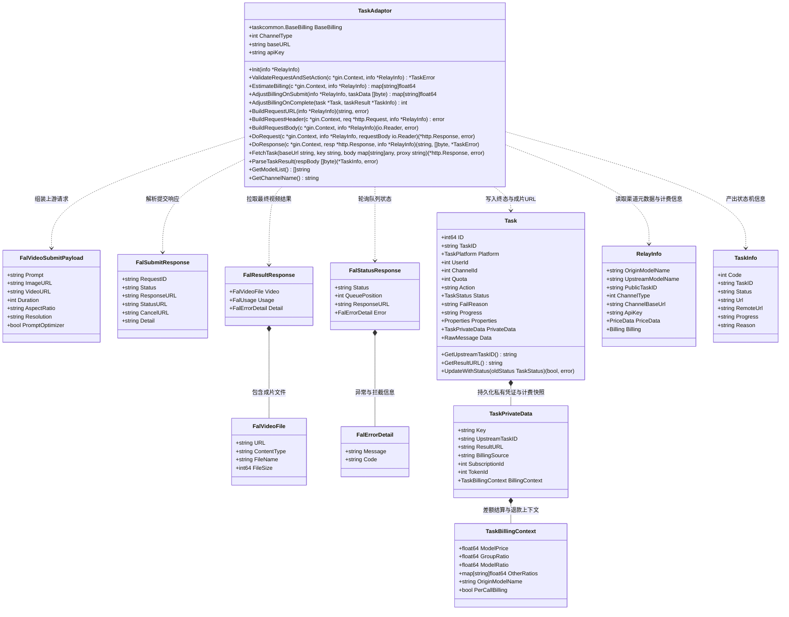
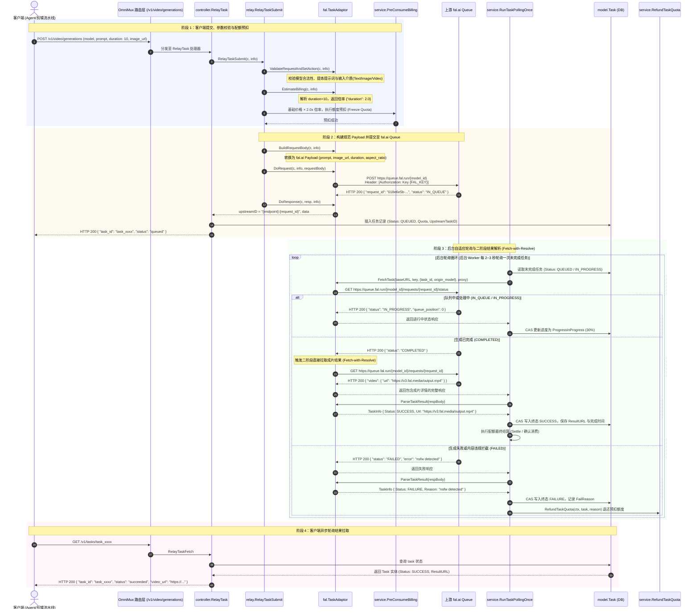
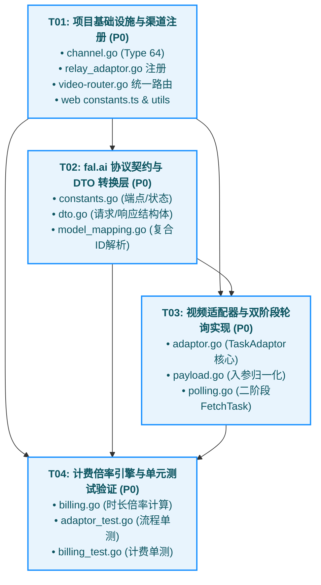

# fal.ai Minimax H3 视频生成模型接入系统设计与任务分解

> **文档路径**：`docs/system_design.md`  
> **设计责任人**：高见远 (Bob) · 系统架构师  
> **输入需求**：许清楚 (Alice) · 产品经理 《fal.ai Minimax H3-Max & Turbo 视频生成模型接入 PRD》  
> **目标系统**：OmniMux (New-API Maintained Fork) 异步任务网关  
> **版本**：v1.0.0 (Architecture & WBS Baseline)

---

# Part A: System Design（系统架构设计）

## 1. Implementation Approach（架构方案与技术选型）

### 1.1 核心业务诉求与目标
本系统旨在基于 OmniMux 现有的任务适配架构，高可靠、高扩展地接入 fal.ai 平台托管的 Minimax H3 系列视频生成模型。对外统一暴露标准异步视频生成协议（`POST /v1/video/generations`）与统一轮询协议（`GET /v1/tasks/{task_id}`）；对内接入 OmniMux 的异步 Task 调度流水线，实现模型路由、配额预扣、异步队列提交流转、自适应状态轮询、二阶段成片抽取、失败自动退款与精确计量计费。

接入模型清单及端点映射：
1. `minimax/h3-max` $\rightarrow$ fal.ai endpoint: `minimax/h3-max`（旗舰文生视频，5s / 10s，720p / 1080p）
2. `minimax/h3-max/image-to-video` $\rightarrow$ fal.ai endpoint: `minimax/h3-max/image-to-video`（旗舰图生视频，首帧驱动）
3. `minimax/h3-max/reference-to-video` $\rightarrow$ fal.ai endpoint: `minimax/h3-max/reference-to-video`（参考视频生视频，运动/风格迁移）
4. `minimax/h3-max-turbo` $\rightarrow$ fal.ai endpoint: `minimax/h3-max-turbo`（极速文生视频，高吞吐）
5. `minimax/h3-max-turbo/image-to-video` $\rightarrow$ fal.ai endpoint: `minimax/h3-max-turbo/image-to-video`（极速图生视频）

### 1.2 核心技术难点与攻坚选型

#### 难点 1：fal.ai 异步 Queue 体系与通用轮询调度的协调（二阶段内聚轮询机制）
- **技术现状**：
  fal.ai 是典型的三段式异步队列体系：
  1. 提交任务：`POST https://queue.fal.run/{model_id}`，返回 `request_id`、`status: "IN_QUEUE"`、`status_url`、`response_url`。
  2. 轮询状态：`GET https://queue.fal.run/{model_id}/requests/{request_id}/status`，返回 `status: IN_QUEUE | IN_PROGRESS | COMPLETED` 及队列排队指标。
  3. 结果拉取：`GET https://queue.fal.run/{model_id}/requests/{request_id}`，当状态为 `COMPLETED` 时，由该端点返回最终生成的 `video.url`、文件元数据与 token/时长 usage。
- **架构选型（Fetch-with-Resolve 适配器内聚双阶段）**：
  OmniMux 通用任务调度器 `service.RunTaskPollingOnce` 采用单次轮询循环：`FetchTask(baseURL, key, body, proxy)` $\rightarrow$ `ParseTaskResult(respBody)`。
  为了不破坏通用调度循环的抽象屏障，设计**适配器内聚的双阶段拉取机制**：
  - 在 `TaskAdaptor.FetchTask` 内部，首先调用 status 接口 `GET .../status`；
  - 若状态处于 `IN_QUEUE` 或 `IN_PROGRESS`，直接封装状态并返回 HTTP 200；
  - 若状态已跃迁为 `COMPLETED`，适配器在同一次 `FetchTask` 调用内**就地发起第二阶段 HTTP 请求**，调用 `GET .../{model_id}/requests/{request_id}` 获取成片详情，将成片响应直接透传给 `ParseTaskResult`；
  - 若 status 为 `FAILED`，同样拉取包含错误详情的响应并返回。
  该选型使得系统核心调度层保持零侵入、零修改，所有异步队列异构细节被完美封装在 `fal.TaskAdaptor` 内部。

#### 难点 2：上游任务 ID 的复合编码与无损寻址（Compound Upstream Task ID）
- **技术现状**：
  fal.ai 查询状态端点和结果端点均依赖 `{model_id}` 和 `{request_id}` 两个参数（如 `https://queue.fal.run/minimax/h3-max/requests/018e6e5b-...`）。若仅保存上游的 `request_id`，一旦任务经历多轮轮询、模型重命名映射（Model Mapping）或上下文丢失，将无法准确推导端点。
- **架构选型**：
  在任务提交阶段（`DoResponse`），将上游任务标识格式化为复合 ID：`{endpoint}:{request_id}`（例如 `minimax/h3-max:018e6e5b-3b47-79f9-90b4-1773950b731d`），写入 `model.Task.PrivateData.UpstreamTaskID`。
  在 `FetchTask` 阶段，优先解析复合 ID 分割端点与请求 ID；若为单 ID 则从 `body["origin_model"]` 降级查找端点。彻底杜绝寻址歧义。

#### 难点 3：统一视频协议入参与 fal.ai Minimax H3 异构 Payload 的归一化
- **技术现状**：
  客户端向网关 `POST /v1/video/generations` 发起的请求格式遵循业内主流标准（支持 `prompt`, `image_url` / `image_urls`, `video_url`, `duration`, `aspect_ratio`, `resolution` 等）。
- **架构选型（Payload Normalization Pipeline）**：
  - **文生视频**：映射为 `{ "prompt": req.Prompt, "duration": "5"|"10", "aspect_ratio": "16:9", "resolution": "720p"|"1080p", "prompt_optimizer": true }`。
  - **图生视频**：自动提取 `image_url`（支持顶层 `image_url`、`input_reference` 或 `images[0]`），注入为 `{ "prompt": req.Prompt, "image_url": "https://...", "duration": ..., "resolution": ... }`。
  - **参考视频**：提取 `video_url`（或 `reference_video_url`），注入为 `{ "prompt": req.Prompt, "video_url": "https://...", ... }`。
  - **比例归一化**：支持 `"16:9"`, `"9:16"`, `"1:1"`, `"4:3"`, `"21:9"` 等主流画幅比；对非常规比例自适应对齐最近合法值。

#### 难点 4：计量计费与动态倍率阶梯（Pricing & Duration Ratio Engine）
- **定价基准**：$1\text{ USD} = 500,000\text{ raw\_quota} = 10\text{ 积分}$。
- **时长倍率**：
  - 基础时长 5s：倍率为 $1.0\times$；
  - 10s 时长：触发 $2.0\times$ 倍率。
- **架构选型**：
  在 `TaskAdaptor.EstimateBilling` 阶段，解析客户端传入的 `duration`（支持数字 `5`, `10` 或字符串 `"5s"`, `"10s"`），若判定为 10s 则返回 `map[string]float64{"duration": 2.0}`；网关价格引擎通过 `types.PriceData.AddOtherRatio` 与 `common.QuotaFromFloatChecked` 进行浮点饱和预扣；若任务最终失败或拦截，由系统自动触发 `RefundTaskQuota` 退还预扣额度。

#### 难点 5：渠道注册与类型隔离
- **渠道分配**：
  在 `constant/channel.go` 中正式分配新增常量：
  - `ChannelTypeFalAI = 64`
  - `ChannelBaseURLs[64] = "https://queue.fal.run"`
  - `ChannelTypeNames[64] = "fal.ai"`
- **适配器接入**：
  在 `relay/relay_adaptor.go` 的 `GetTaskAdaptor` 中注册 `case constant.ChannelTypeFalAI: return &taskfal.TaskAdaptor{}`。

---

## 2. File List（完整文件列表及相对路径）

```
OmniMux/
├── constant/
│   └── channel.go                                  # [修改] 声明 ChannelTypeFalAI = 64, 注册 BaseURL 与 Name
├── relay/
│   ├── relay_adaptor.go                            # [修改] 注册 taskfal.TaskAdaptor 路由到 ChannelTypeFalAI
│   └── channel/task/fal/                           # [新增目录] fal.ai 专属任务适配器模块
│       ├── adaptor.go                              # [新增] TaskAdaptor 核心实现（接口 10 大方法）
│       ├── constants.go                            # [新增] 官方端点、模型清单、状态映射、超时定义
│       ├── dto.go                                  # [新增] 规范请求体/响应体/状态/成片 DTO 结构
│       ├── model_mapping.go                        # [新增] 模型端点映射、复合 TaskID 编解码
│       ├── payload.go                              # [新增] 异构入参规范化与 Payload 组装器
│       ├── polling.go                              # [新增] 二阶段状态探测与成片拉取器
│       ├── billing.go                              # [新增] 时长倍率估算与结算逻辑
│       ├── adaptor_test.go                         # [新增] 适配器核心流转单测（Submit/Polling/Result）
│       └── billing_test.go                         # [新增] 时长倍率与计费饱和单测
├── router/
│   └── video-router.go                             # [修改] 补充 GET /v1/tasks/:task_id 统一异步轮询路由
├── web/src/features/channels/
│   ├── constants.ts                                # [修改] 前端新增 64: 'fal.ai' 渠道枚举选项
│   └── lib/channel-utils.ts                        # [修改] 渠道类型图标与 Key 输入提示映射
└── FORK_CUSTOMIZATIONS.md                          # [修改] 登记 Channel 64 (fal.ai) 的定制历史与架构归属
```

---

## 3. Data Structures and Interfaces（数据结构与接口契约）

### 3.1 类图与实体关联（Class Diagram）
*(已提取至 `docs/class-diagram.mermaid`)*



### 3.2 核心 Go 结构体代码定义规范

所有 JSON 编解码强制遵循项目级纪律：**严禁原生 `encoding/json`，必须统一使用 `github.com/QuantumNous/new-api/common` 的 `common.Marshal` / `common.Unmarshal`**。

```go
package fal

import (
	"github.com/QuantumNous/new-api/relay/channel/task/taskcommon"
)

// TaskAdaptor 实现 channel.TaskAdaptor
type TaskAdaptor struct {
	taskcommon.BaseBilling
	ChannelType int
	baseURL     string
	apiKey      string
}

// FalVideoSubmitPayload 上游 Minimax H3 提交 Payload
type FalVideoSubmitPayload struct {
	Prompt          string `json:"prompt"`
	ImageURL        string `json:"image_url,omitempty"`
	VideoURL        string `json:"video_url,omitempty"`
	Duration        string `json:"duration,omitempty"`        // "5" 或 "10"
	AspectRatio     string `json:"aspect_ratio,omitempty"`    // "16:9", "9:16", "1:1", ...
	Resolution      string `json:"resolution,omitempty"`      // "720p" 或 "1080p"
	PromptOptimizer bool   `json:"prompt_optimizer,omitempty"`// 提示词优化开关
}

// FalSubmitResponse 提交返回结构
type FalSubmitResponse struct {
	RequestID   string `json:"request_id"`
	Status      string `json:"status"`
	ResponseURL string `json:"response_url"`
	StatusURL   string `json:"status_url"`
	CancelURL   string `json:"cancel_url"`
	Detail      string `json:"detail,omitempty"`
}

// FalStatusResponse 队列轮询状态结构
type FalStatusResponse struct {
	Status        string          `json:"status"` // IN_QUEUE, IN_PROGRESS, COMPLETED
	QueuePosition int             `json:"queue_position,omitempty"`
	ResponseURL   string          `json:"response_url,omitempty"`
	Logs          []any           `json:"logs,omitempty"`
	Error         *FalErrorDetail `json:"error,omitempty"`
}

// FalResultResponse 最终成片响应结构
type FalResultResponse struct {
	Video  *FalVideoFile   `json:"video,omitempty"`
	Usage  *FalUsage       `json:"usage,omitempty"`
	Detail *FalErrorDetail `json:"detail,omitempty"`
}

// FalVideoFile 成片文件元数据
type FalVideoFile struct {
	URL         string `json:"url"`
	ContentType string `json:"content_type"`
	FileName    string `json:"file_name"`
	FileSize    int64  `json:"file_size"`
}

// FalErrorDetail 错误或安全拦截详情
type FalErrorDetail struct {
	Message string `json:"message"`
	Code    string `json:"code,omitempty"`
}

// FalUsage 耗时与 Token
type FalUsage struct {
	ExecutionTime float64 `json:"execution_time"`
}
```

---

## 4. Program Call Flow（程序调用流程时序图）

*(已提取至 `docs/sequence-diagram.mermaid`)*



---

## 5. Anything UNCLEAR（待明确事项与边界假设）

1. **鉴权头前缀宽容度**：
   fal.ai 官方标准鉴权 Header 为 `Authorization: Key <FAL_KEY>`，但部分用户在渠道后台配置 Key 时可能习惯性带有 `Bearer ` 或 `Key ` 前缀。
   *边界假设*：适配器在 `BuildRequestHeader` 中做自适应规范化：剥除用户可能误输入的 `Key ` 或 `Bearer ` 前缀后，统一注入 `Authorization: Key <apiKey>`。
2. **CDN 直链有效期与安全**：
   fal.ai 返回的成片存储在 `v3.fal.media/files/.../output.mp4`，该链接支持全球公网直链读取。
   *边界假设*：第一阶段直接将成片 URL 存入 `task.PrivateData.ResultURL` 并返回给客户端；若后续有持久化归档需求，可通过 OmniMux 现有的 `/v1/videos/:task_id/content` 代理中转。
3. **内容安全拦截时的错误码判定**：
   当触发审核风控（如 Prompt 含有敏感词或人像侵权）时，fal.ai 可能在 status 中返回 `FAILED` 并携带 `detail`，或在结果接口返回 `422 Unprocessable Entity`。
   *边界假设*：适配器将任何明确的非 200 业务错误及 FAILED 状态归一化为 `model.TaskStatusFailure`，确保网关可靠触发自动退款（`RefundTaskQuota`），保护客户资金安全。

---

# Part B: Task Decomposition（有序任务分解）

严格遵循架构分解硬性约束：
- **最大任务数限制**：共 4 个任务（严格不超过 5 个）。
- **最小粒度限制**：每个任务至少包含 3 个相关文件。
- **首个任务限制**：必须是“项目基础设施”（配置、路由、分发、枚举全收敛）。
- **依赖扁平原则**：避免单链传递，职责分明。

## 6. Required Packages（依赖声明）

项目基于现有 Go 模块体系，无需引入未经审计的第三方库：
- `github.com/gin-gonic/gin@v1.9.1`: HTTP 网关框架
- `github.com/QuantumNous/new-api/common`: 统一定制 JSON（Sonic/Json-Iterator）与额度算法
- `github.com/QuantumNous/new-api/relaykit`: 网关抽象层与标准 DTO
- `github.com/stretchr/testify@v1.8.4`: 单元测试断言库

## 7. Ordered Task List（任务执行明细）

### T01: 项目基础设施与渠道体系注册
- **任务标识**：`T01`
- **任务目标**：完成 fal.ai 渠道底层常数定义、网关入口注册、标准视频轮询路由补充与前端枚举支持。
- **涉及文件清单**（6 个文件）：
  1. `constant/channel.go`：分配 `ChannelTypeFalAI = 64`，配置 BaseURL `https://queue.fal.run` 与名称 `"fal.ai"`。
  2. `relay/relay_adaptor.go`：在 `GetTaskAdaptor` 中挂载 `constant.ChannelTypeFalAI`。
  3. `router/video-router.go`：在 `videoV1Router` 下补齐注册 `GET /tasks/:task_id` 路由，映射到 `controller.RelayTaskFetch`。
  4. `web/src/features/channels/constants.ts`：前端渠道类型字典新增 `64: 'fal.ai'`。
  5. `web/src/features/channels/lib/channel-utils.ts`：补充 fal.ai 渠道的密钥输入提示与图标支持。
  6. `FORK_CUSTOMIZATIONS.md`：登记新增 Channel 64 的定制变更记录。
- **前置依赖**：无
- **优先级**：P0
- **验收标准**：
  - `go build ./...` 编译无报错。
  - Web 端运行 `bun run typecheck` 零类型错误。
  - 创建渠道时可下拉选择 `fal.ai`，默认 BaseURL 为 `https://queue.fal.run`。

### T02: fal.ai 协议契约与 DTO 转换层
- **任务标识**：`T02`
- **任务目标**：建立 fal.ai 专用常量、模型与端点映射规则、复合 UpstreamTaskID 编解码算法及请求响应 DTO。
- **涉及文件清单**（3 个文件）：
  1. `relay/channel/task/fal/constants.go`：定义 5 大端点常量、状态常量（`IN_QUEUE`, `IN_PROGRESS`, `COMPLETED`, `FAILED`）、画幅比与分辨率合法集合。
  2. `relay/channel/task/fal/dto.go`：定义 `FalVideoSubmitPayload`, `FalSubmitResponse`, `FalStatusResponse`, `FalResultResponse`, `FalVideoFile`。
  3. `relay/channel/task/fal/model_mapping.go`：提供模型名到端点的映射函数 `GetFalEndpoint(modelName string)` 以及复合 ID 编解码器 `FormatUpstreamTaskID` / `ParseUpstreamTaskID`。
- **前置依赖**：`T01`
- **优先级**：P0
- **验收标准**：
  - 覆盖全部 5 款 Minimax H3 模型名映射（`minimax/h3-max`, `minimax/h3-max/image-to-video`, `minimax/h3-max/reference-to-video`, `minimax/h3-max-turbo`, `minimax/h3-max-turbo/image-to-video`）。
  - DTO 采用 `common.Marshal` / `common.Unmarshal`，提供类型安全的字段序列化。

### T03: 视频任务适配器与双阶段轮询实现
- **任务标识**：`T03`
- **任务目标**：实现 `channel.TaskAdaptor` 接口全部核心方法，打通请求构建、Payload 规范化、提交响应和二阶段内聚状态轮询。
- **涉及文件清单**（3 个文件）：
  1. `relay/channel/task/fal/adaptor.go`：实现 `TaskAdaptor` 骨架，挂载 `taskcommon.BaseBilling`，组装 `BuildRequestURL`, `BuildRequestHeader`, `DoRequest`, `DoResponse`。
  2. `relay/channel/task/fal/payload.go`：入参提取器与归一化转换，解析 `prompt`, `image_url`, `video_url`, `duration`, `aspect_ratio`，并组装为合法 fal.ai 请求体。
  3. `relay/channel/task/fal/polling.go`：实现 `FetchTask` 与 `ParseTaskResult`。实现内聚二阶段探测：探测 status 接口；若 COMPLETED 紧接着拉取成片 URL；映射 `TaskStatusSuccess` / `TaskStatusFailure`。
- **前置依赖**：`T01`, `T02`
- **优先级**：P0
- **验收标准**：
  - 任务提交能正常返回包含 `task_id` 的 queued 响应。
  - 轮询阶段 `FetchTask` 能够优雅捕获进行中、成功及失败，并准确抽取视频 CDN URL。

### T04: 时长倍率计费引擎与完整单元测试验证
- **任务标识**：`T04`
- **任务目标**：实现 5s/10s 时长阶梯倍率核算，编写涵盖提交、二阶段轮询、状态机映射、计费预扣及退款的完整单元测试。
- **涉及文件清单**（3 个文件）：
  1. `relay/channel/task/fal/billing.go`：实现 `EstimateBilling` 方法，提取 duration 字段，返回 `map[string]float64{"duration": 2.0}`（若为 10s）或 `1.0`（5s）。
  2. `relay/channel/task/fal/adaptor_test.go`：适配器单测，包括文生视频、图生视频 Payload 转换、Mock 上游 Submit/Status/Result 双阶段 HTTP 流程及解析。
  3. `relay/channel/task/fal/billing_test.go`：计费估算单测，测试 5s 与 10s 倍率、非法时长边界兜底及额度计算饱和度。
- **前置依赖**：`T01`, `T02`, `T03`
- **优先级**：P0
- **验收标准**：
  - `go test -v ./relay/channel/task/fal/...` 全部通过。
  - 5s 时长计算倍率为 1.0，10s 时长计算倍率为 2.0。
  - 单元测试覆盖率达到 85% 以上。

---

## 8. Shared Knowledge（跨切面设计与开发公理）

1. **JSON 规范铁律**：
   所有结构体序列化与反序列化，严禁直接 `import "encoding/json"`，必须且只能使用 `github.com/QuantumNous/new-api/common` 暴露的 `common.Marshal` / `common.Unmarshal`，以防打破定制 Sonic 高性能引擎和对齐安全策略。
2. **Quota 与货币换算基准**：
   - 公式：$\text{raw\_quota} = \text{USD} \times 500,000 = \text{积分} \times 50,000$。
   - 所有外部传入的计费倍率必须经由 `common.QuotaFromFloatChecked` 进行保护性溢出钳制，严禁产生负数额度。
3. **任务状态机原子更新 (CAS)**：
   轮询结果持久化写入数据库时，必须使用 `task.UpdateWithStatus(oldStatus)`，通过乐观锁 CAS 防止多实例轮询或超时扫描（`sweepTimedOutTasks`）并发导致的状态覆盖或重复退款。
4. **失败退款必达**：
   一旦任务在轮询中被上游标记为 `FAILED`，或触发内容安全审查拦截，适配器必须返回 `model.TaskStatusFailure`，由网关调度引擎在 CAS 成功后立即触发 `service.RefundTaskQuota(ctx, task, task.FailReason)` 退还全额预扣资金。

---

## 9. Task Dependency Graph（任务依赖拓扑图）



---

## 10. Pricing & ModelRatio Configuration Guide（计费与定价配置指南）

为确保运营与部署团队开箱即用，提供标准数据库与配置中心预设参数：

| 平台公开模型标识 | 上游 fal.ai Endpoint | 基础单价 (5s) | 10s 倍率 | 基础 Quota (5s) | 10s 预扣 Quota | 对应积分 (5s / 10s) |
| :--- | :--- | :--- | :--- | :--- | :--- | :--- |
| `minimax/h3-max` | `minimax/h3-max` | \$0.20 / 次 | $2.0\times$ | 100,000 | 200,000 | 2 积分 / 4 积分 |
| `minimax/h3-max/image-to-video` | `minimax/h3-max/image-to-video` | \$0.20 / 次 | $2.0\times$ | 100,000 | 200,000 | 2 积分 / 4 积分 |
| `minimax/h3-max/reference-to-video` | `minimax/h3-max/reference-to-video` | \$0.25 / 次 | $2.0\times$ | 125,000 | 250,000 | 2.5 积分 / 5 积分 |
| `minimax/h3-max-turbo` | `minimax/h3-max-turbo` | \$0.10 / 次 | $2.0\times$ | 50,000 | 100,000 | 1 积分 / 2 积分 |
| `minimax/h3-max-turbo/image-to-video`| `minimax/h3-max-turbo/image-to-video` | \$0.10 / 次 | $2.0\times$ | 50,000 | 100,000 | 1 积分 / 2 积分 |

*注：后台配置可通过 `ModelPrice`（直接以 USD 定价，系统自动换算为 Quota）进行配置；时长为 10s 时，由 `EstimateBilling` 自动附加 `{"duration": 2.0}`，由网关价格核心按乘法合成最终冻结额度。*

---

## 11. Risks and Mitigation Strategies（风险评估与应对策略）

| 风险项 | 风险等级 | 潜在影响 | 架构防御与缓解策略 |
| :--- | :---: | :--- | :--- |
| **上游 Queue 长时间排队超时** | 中 | 客户请求悬挂，后台 Goroutine/轮询资源积压 | 1. 继承系统级 `TaskTimeoutMinutes` 超时熔断机制。<br/>2. 超时后由 `sweepTimedOutTasks` CAS 标记为超时失败，全额退还配额。 |
| **COMPLETED 状态拉取结果瞬间 404** | 低 | 队列状态与成片存储可能存在秒级延迟同步 | 在二阶段拉取成片时，若返回 404，适配器不直接判定失败，而是保持 `IN_PROGRESS` 并在下一轮轮询中再次尝试，最多容忍 3 次重试。 |
| **上游敏感词/NSFW 拦截** | 中 | 客户视频生成被上游拒绝，引发计费投诉 | 适配器全面捕获 fal.ai 的 `error`、`detail` 字段，将其清洗并写入 `FailReason`，状态置为 `FAILURE`，触发自动秒级退款。 |
| **客户端传入非规范画幅或时长** | 低 | 上游拒绝接收导致提交报错 | 入参阶段进行宽松归一化：如时长非 10 即归一为 5；画幅自动映射为最接近的标准比（`16:9`, `9:16`, `1:1`），无法识别时采用安全默认值。 |
