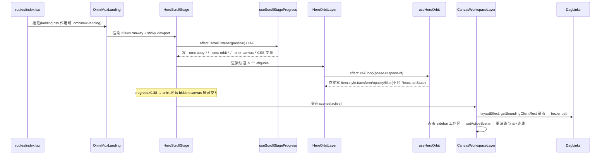
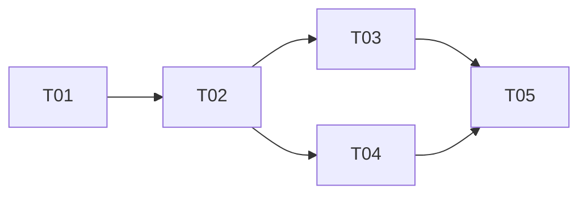

# OmniMux 官网落地页重构 — 架构设计 + 任务分解

> **历史材料（2026-10-08 标识）：** 本文仅保留当时的方案、证据与审查结论，不是现行产品要求或当前上线证明。旧的“无订阅”、AI UGC 团队、策划到发布复盘全链路、商品/SKU 起步、旧页面结构与路径、用户手选模型/分组规则不得据此恢复；技术请求与素材契约不因品牌收敛而自动改变。当前依据见 [品牌规范](../brand/README.md) 与 [落地页文案与实现](../brand/landing-page-copy.md)。

> 架构师：Bob(高见远) · 目标 worktree:`.worktrees/landing-revamp` · Demo 基准:`.tmp-demos/minimax-hero-orbit/index.html`

## Part A:系统设计

### 1. 实现方案与框架选型结论

**核心技术难点与结论**

| 难点 | Demo 实现 | React 迁移策略 | 结论 |
|---|---|---|---|
| Screen1 3D 旋转轨道 | 原生 JS rAF + `translate3d` + 椭圆参数方程 + 拖拽惯性 | **自研 hook**(`useHeroOrbit`),组件只渲染 `<figure>` 列表,transform 由 hook 直接写 DOM style(绕过 React 渲染管线,60fps) | 不引入 three.js;CSS 3D 零依赖 |
| Screen1→2 滚动变形(sticky morph) | 220vh scroll runway + sticky viewport + scroll 事件写 CSS 变量 | `useScrollStageProgress(ref)` 返回 rAF 节流 progress,写入 stage 元素的 CSS 自定义属性;两层 `.omx-stage-layer` 纯 CSS 消费变量 | 保留 Demo 的「变量驱动」模式,仅把宿主从 `documentElement` 改为 stage 根元素(作用域隔离) |
| Screen2 Canvas 节点 DAG | 实际**不是** `<canvas>` 2D,而是 DOM 节点 + SVG bezier 连线 + 数据驱动(WS_DATA) | 纯 React 组件树:`DagNode` 按 kind 分发渲染,`DagLinks` 用 `useLayoutEffect`+`ResizeObserver` 计算锚点后渲染 `<path>` | **无 Canvas API,无需 canvas mock**;测试友好 |
| Screen3 步骤轮播 | rAF 无限左滚 + 相位累加器(不回绕)+ 1:1 拖拽 + 惯性 + hover 暂停 + 3D tilt | `useInfiniteCarousel(trackRef, { itemWidth, speed })`:hook 管相位/拖拽/惯性,组件克隆一遍卡片实现无缝;`useCardTilt` 独立 hook | 状态机收敛为 hook 内部 ref,组件无状态 |
| 打字机 | setTimeout 链 | `useTypewriter(phrases)` hook,尊重 `prefers-reduced-motion` | 文案走 i18n `returnObjects` |
| Demo 数据随机化(轨道 28 抽 14、轮播 AB 变体) | fetch manifest + sessionStorage AB | **降级**:轨道素材改为静态数组(素材池未入库,见风险 R1);AB 变体废弃,固定采用变体 C(与「全链路 API」定位一致) | 见风险 R1/R2 |

**架构模式**:每屏一个 Section 组件(纯展示)+ `hooks/` 承载全部命令式动效 + `lib/` 承载数据与纯函数。组件不持有动效状态,所有 rAF/scroll 监听在 hook 内注册并在 cleanup 中注销。

### 2. 组件树与文件清单

```
features/omnimux-landing/
├── index.tsx                        [改] 新 6 屏编排:Header→HeroScrollStage→WorkflowCarousel→ChannelMatrix→PluginMarket→DownloadCta→Footer
├── landing.css                      [改] 627 行暗色 token → 浅色 token 全量重写(见 §6)
├── types.ts                         [新] DagNode/DagEdge/WorkflowScene/StepCard/PluginCard/ChannelTile 类型
├── assets/                          [保留] 已拷贝(octo_*、cards/omni-card-1..4.jpg、dag/*)
├── hooks/
│   ├── use-scroll-stage-progress.ts [新] scroll → rAF 节流 progress(0..1),写 CSS 变量
│   ├── use-hero-orbit.ts            [新] 轨道相位/拖拽/惯性/视频播放门控
│   ├── use-typewriter.ts            [新] 打字/删除循环
│   ├── use-infinite-carousel.ts     [新] 相位累加 + 拖拽 + 惯性 + hover 暂停
│   └── use-card-tilt.ts             [新] 卡片 3D tilt + glare 高光
├── lib/
│   ├── landing-urls.ts              [保留] DOCS_URL / CLI_GITHUB_URL
│   ├── install-commands.ts          [保留] Screen6 复用安装命令
│   ├── copy-text.ts                 [保留]
│   ├── download-links.ts            [新] Desktop dmg/exe 下载 URL(集中管理,版本号一处改)
│   ├── dag-scenes.ts                [新] 4 个工作区 DAG 数据(节点/边/资产 import)
│   ├── channel-catalog.tsx          [新] 取代 platform-catalog.ts:18 平台 {id,nameKey,icon:ReactNode}
│   ├── plugin-cards.ts              [新] 4 张插件卡数据(配图 import assets/cards)
│   └── workflow-steps.ts            [新] 5 张步骤卡数据(图片暂用 cards/* 占位,见 R2)
├── components/
│   ├── landing-header.tsx           [改] 暗色 → 浅色 glass header(#faf8f5/82 + blur)
│   ├── landing-footer.tsx           [改] 改版为 Demo 页脚:#f6f5f2 背景 + 链接分组
│   ├── logo-mark.tsx                [保留]
│   ├── reveal.tsx                   [保留] omx-reveal/omx-in 约定不变
│   ├── download-chooser.tsx         [新] macOS(M/Intel 下拉)+ Windows 按钮,Screen1/6 共用
│   ├── hero-scroll-stage.tsx        [新·S1+S2] 220vh runway + sticky 视口 + 双层 morph
│   ├── hero-orbit-layer.tsx         [新·S1] 3D 轨道 + 中心 copy + 打字机 + 滚动提示
│   ├── canvas-workspace-layer.tsx   [新·S2] 三栏窗口:sidebar + DAG 画布 + copilot 抽屉
│   ├── dag-node.tsx                 [新·S2] kind∈thumb/portrait/wide/square/text/audio/gen 分发
│   ├── dag-links.tsx                [新·S2] SVG bezier 连线(锚点计算)
│   ├── workflow-carousel.tsx        [新·S3] 标题 + 无限轮播 + prev/next + tilt
│   ├── channel-matrix.tsx           [新·S4] 3 行×6 平台 + 双侧 mask,静态(无 rAF)
│   ├── plugin-market.tsx            [新·S5] 头部双栏 + 6 能力分类 + 4 卡 grid
│   ├── download-cta.tsx             [新·S6] 紫色渐变卡 + DownloadChooser + octo_agent_inspect.png
│   └── __tests__/                   [改] 删旧增新(见 §7)
└── 删除: hero.tsx, built-for-automation.tsx, audience.tsx, capability-features.tsx,
    models-tools.tsx, wall-of-love.tsx, faq.tsx, quick-start.tsx, final-cta.tsx,
    hero-install-card.tsx, pay-funnel.tsx, platform-catalog.ts 及其 __tests__ 用例
```

**关键 props 接口**(全部 `export interface`,组件内用 `props.xxx` 访问,不解构):

```ts
// download-chooser.tsx
export interface DownloadChooserProps { size?: 'md' | 'lg'; tone?: 'dark' | 'light' }

// hero-orbit-layer.tsx
export interface HeroOrbitLayerProps { assets: OrbitAsset[] } // { id, src, poster? }

// canvas-workspace-layer.tsx
export interface CanvasWorkspaceLayerProps { scenes: WorkflowScene[]; initialSceneId: string }

// dag-links.tsx
export interface DagLinksProps { edges: DagEdge[]; containerRef: RefObject<HTMLElement>; epoch: number }

// workflow-carousel.tsx
export interface WorkflowCarouselProps { steps: StepCard[] }

// channel-matrix.tsx — 无 props,数据来自 channel-catalog
// plugin-market.tsx — 无 props,数据来自 plugin-cards
// download-cta.tsx — 无 props,复用 DownloadChooser
```

### 3. 数据与接口设计

```ts
// types.ts
export type DagNodeKind = 'thumb' | 'portrait' | 'wide' | 'square' | 'text' | 'audio' | 'gen'

export interface DagNode {
  id: string
  kind: DagNodeKind
  labelKey: string          // i18n key
  badge?: string            // 'L1' | 'L2' | 'L3'(级联层,≤3)
  top: number; left: number // 画布内绝对定位(px,Demo 设计稿坐标系)
  media?: { type: 'image' | 'video' | 'audio'; src: string }
  bodyKey?: string          // kind==='text'
  titleKey?: string; subKey?: string // kind==='gen'
}
export interface DagEdge { from: string; to: string }
export interface WorkflowScene {
  id: string                // 'ugcTalk' | 'skincareUgc' | 'viralRecreate' | 'keyframeVideo'
  titleKey: string; userPromptKey: string; thoughtKey: string
  thumbSrc: string          // sidebar 缩略图
  nodes: DagNode[]; edges: DagEdge[]
}

export interface StepCard { sysKey: string; titleKey: string; descKey: string; tags: string[]; imageSrc: string }
export interface PluginCard { labelKey: string; nameKey: string; tagsKeys: string[]; briefKey: string; imageSrc: string }
export interface ChannelTile { id: string; name: string; icon: ReactNode } // 内联 SVG 白名单
export interface OrbitAsset { id: string; src: string; poster?: string }
```

**18 平台**(channel-catalog.tsx,Demo 原样,全部为海外平台;白名单 6 个排第一行):
行1: X, LinkedIn, YouTube, Instagram, TikTok, Threads
行2: Facebook, Discord, Telegram, Reddit, Bluesky, Pinterest
行3: Slack, Mastodon, Dribbble, VK, Lemmy, Warpcast
⚠️ 行2/3 超出产品白名单(X/LinkedIn/YouTube/Instagram/TikTok/Threads),是否保留见风险 R3。

### 4. 程序调用流



### 5. 不明确点与假设

- **假设 A1**:Screen1 轨道素材降级为静态数组(≤8 项,复用 dag/*.mp4 + 缩略图),`videos-manifest.json` 28 素材池未入库 → R1。
- **假设 A2**:轮播固定变体 C,废弃 sessionStorage AB → R2。
- **假设 A3**:Screen2 copilot 抽屉为纯展示(演示态),输入框不发送。
- **假设 A4**:promo 顶部公告条**不迁移**(含倒计时,营销内容由 PM 另行决策)。

## Part B:任务分解

### 6. 所需依赖

无新增第三方依赖。复用:react@19、react-i18next、@tanstack/react-router、tailwindcss、clsx/cn、vitest、@testing-library/react。媒体资产走 Rsbuild 静态 import(`import src from '../assets/dag/xxx.mp4'`)。

### 7. 任务列表(≤5,按依赖排序)

| ID | 任务 | 文件 | 依赖 | 优先级 |
|---|---|---|---|---|
| T01 | **基础设施**:浅色 token 重写 + 新编排骨架 + 全部数据层 + i18n 注册 | `landing.css`、`index.tsx`、`types.ts`、`lib/download-links.ts`、`lib/dag-scenes.ts`、`lib/channel-catalog.tsx`、`lib/plugin-cards.ts`、`lib/workflow-steps.ts`、`i18n/static-keys.ts`(+`locales/en.json` 占位) | — | P0 |
| T02 | **共享交互层**:5 个动效 hooks + 共用件 | `hooks/use-scroll-stage-progress.ts`、`hooks/use-hero-orbit.ts`、`hooks/use-typewriter.ts`、`hooks/use-infinite-carousel.ts`、`hooks/use-card-tilt.ts`、`components/download-chooser.tsx`、`components/dag-node.tsx`、`components/dag-links.tsx` | T01 | P0 |
| T03 | **Screen1+2 滚动舞台**(Hero 轨道 + DAG 工作区) | `components/hero-scroll-stage.tsx`、`hero-orbit-layer.tsx`、`canvas-workspace-layer.tsx` + 对应 `__tests__` | T02 | P0 |
| T04 | **Screen3+4+5**(轮播 / 平台矩阵 / 插件广场) | `components/workflow-carousel.tsx`、`channel-matrix.tsx`、`plugin-market.tsx` + `__tests__` | T02 | P0 |
| T05 | **Screen6 + Header/Footer 改版 + 旧代码清除 + 收尾验证** | `components/download-cta.tsx`、`landing-header.tsx`、`landing-footer.tsx`;删除 11 个旧 section 组件及旧测试;`bun run build:check`、`bun run lint`、`bun run i18n:sync`、受影响测试 | T03, T04 | P0 |



### 8. 共享约定

1. **CSS 作用域**:所有样式必须位于 `.omnimux-landing` 选择器内;类名 BEM 风格 `omx-<block>__<elem>--<mod>`(如 `omx-hero-orbit__item`),避免与 Demo 原类名混淆。
2. **Token 体系**(浅色重写):
   ```
   --omx-bg:#faf8f5; --omx-bg-elevated:#ffffff; --omx-bg-muted:#f6f5f2;
   --omx-text:#0c0f17; --omx-text-muted:#5a6578; --omx-text-faint:#8a94a6;
   --omx-brand:#6757e7; --omx-brand-accent:#7961f2; --omx-cta-grad:linear-gradient(135deg,#6c5cf0,#8a79f5 55%,#a08efc);
   --omx-border:rgba(12,15,23,.08); --omx-border-strong:rgba(12,15,23,.16);
   ```
   移除 `color-scheme: dark` 与 `html:has(.omnimux-landing)` 暗色覆盖;保留 Geist 字体 import 与 `.omx-shell`、`.omx-btn-primary/secondary`(改为浅色语义)。
3. **动效性能**:rAF 循环内禁止 setState;transform/opacity/filter 直写 DOM;scroll 监听 `passive:true` + rAF 节流;全部动画尊重 `prefers-reduced-motion`(Reveal 已有先例,新 hook 同样短路)。
4. **资产 import**:一律静态 `import` 自 `../assets/…`(Rsbuild 处理 URL),禁止字符串路径拼 `/landing/...`。
5. **Reveal 约定**:屏级标题/卡片统一 `<Reveal>` 包裹,`delay` 递增 60–120ms;不新增其他入场动画库。
6. **i18n**:组件内 `useTranslation()`;动态 key(数组/常量驱动)全部登记 `static-keys.ts`;DAG 节点 label、轮播 tags 等列表型文案用 `t(key, { returnObjects: true })` 并在 static-keys 逐条登记。
7. **定位红线**:平台/文案只允许海外平台;计费表述固定 `pay per call / 按调用付费,no subscription / 无需订阅`。

### 9. i18n key 清单(命名空间 `omnimux_landing.*`)

旧 key(`hero.*`、`audience.*`、`capability.*`、`modelsTools.*`、`wallOfLove.*`、`faq.*`、`quickStart.*`、`finalCta.*` 等)**全部删除**,替换为:

```
# 保留:nav.* / cta.getStarted / footer 中原有有效 key 视改版情况保留
omnimux_landing.hero.brandAccent        = "Desktop"               # 或去掉,见 R4
omnimux_landing.hero.typewriter         = [5 条短语, returnObjects]
omnimux_landing.hero.downloadMac        = "Download for macOS"
omnimux_landing.hero.downloadWin        = "Download for Windows"
omnimux_landing.hero.macArm             = "Mac (Apple Silicon)"
omnimux_landing.hero.macIntel           = "Mac (Intel)"
omnimux_landing.hero.macReq             = "M1/M2/M3/M4 · macOS 13+"
omnimux_landing.hero.scrollCue          = "Scroll to explore the canvas"
omnimux_landing.hero.shuffle            = "Shuffle assets"        # 若轨道保留 shuffle

omnimux_landing.dag.sidebar.newChat     / .newProject
omnimux_landing.dag.sidebar.menu.{account,creation,publish,analytics,assets,inspiration,products}
omnimux_landing.dag.sidebar.projects    = "Workspaces"
omnimux_landing.dag.scenes.ugcTalk.{title,user,thought} (+ nodes 每节点 labelKey)
omnimux_landing.dag.scenes.skincareUgc.{...}
omnimux_landing.dag.scenes.viralRecreate.{...}
omnimux_landing.dag.scenes.keyframeVideo.{...}
omnimux_landing.dag.copilot.inputPlaceholder / .showMore / .skillsBadge

omnimux_landing.steps.title             = "Make social operations fully AI-automated"
omnimux_landing.steps.subtitle
omnimux_landing.steps.prev / .next      (aria-label)
omnimux_landing.steps.items.0..4.{sys,title,desc}   (tags 为英文常量,不走 i18n)

omnimux_landing.matrix.title            = "Covering the mainstream social platform matrix"
omnimux_landing.matrix.desc

omnimux_landing.plaza.title             = "Plugin plaza, use on demand"
omnimux_landing.plaza.sub / .sideLabel
omnimux_landing.plaza.cats.0..5         (短剧/故事板/商业广告/电子商务/音频音乐/平台工具 — 需 PM 按定位复核)
omnimux_landing.plaza.cards.{expert,skill,plugin,connector}.{name,brief} + .tags(returnObjects)

omnimux_landing.cta.downloadTitle       = "Download OmniMux…"
omnimux_landing.cta.downloadSub
omnimux_landing.cta.payPerCall          = "Pay per call, no subscription"

omnimux_landing.footer.tagline          = "TikTok marketing content automation"
omnimux_landing.footer.cols.{product,developer,company} + 各项 label
```

### 10. 测试策略(Vitest + RTL,`__tests__/` 内)

| 组件 | 要点 |
|---|---|
| download-chooser | 点击展开/收起下拉、`aria-expanded` 同步、Esc/外点关闭、两个 dmg 链接 href 正确 |
| use-typewriter | fake timers 推进打字/删除;reduced-motion 直接显示完整短语 |
| hero-orbit-layer | `requestAnimationFrame` 用 `vi.stubGlobal` 手动步进;**video.play/pause 在 happy-dom 不存在 → `HTMLMediaElement.prototype.play = vi.fn(()=>Promise.resolve())`**;断言 item transform 被写入、拖拽 pointerdown/move 改变相位 |
| use-scroll-stage-progress | mock `getBoundingClientRect` + 派发 scroll;断言 CSS 变量落在 stage 元素而非 documentElement;阈值 0.38 切换 is-hidden |
| canvas-workspace-layer | 点击 sidebar 工作区切换 active、copilot 标题/气泡更新;DagLinks:`getBoundingClientRect` mock 固定矩形,断言 `<path d>` 生成且边数正确;audio 节点 play 按钮切换图标 |
| workflow-carousel | rAF 步进断言 track transform 左移;prev/next 各移动一个卡宽;hover 暂停;touch 拖拽 |
| channel-matrix | 渲染 18 tile × 3 行;**断言无国内平台 id**(回归守护);两侧 mask 类名存在 |
| plugin-market | 4 卡渲染、配图 src、tag 数 |
| download-cta | 复用 DownloadChooser 行为;octo 图 alt 为空(装饰性 `aria-hidden`) |
| landing-header/footer | 浅色类名 smoke + 链接 href;footer 链接分组完整 |

### 11. 风险与待确认事项

| ID | 事项 | 建议 |
|---|---|---|
| R1 | **Screen1 轨道素材池缺失**:`videos-manifest.json` 28 个竖屏视频未拷贝进 worktree(assets 仅 dag/ 下 2 个 mp4)。Demo 的「随机抽 14」无法实现 | 短期:静态数组复用现有素材;正式:PM/设计补齐素材池或改为图片卡。**开工前需确认** |
| R2 | Screen3 轮播配图 `omni-01..05.jpg` 未入库(assets/cards 只有 omni-card-1..4.jpg) | 先用 cards/* 占位;PM 补齐 5 张步骤配图 |
| R3 | 平台矩阵 18 平台中含 Discord/Telegram/Reddit/Pinterest/Slack/Mastodon/Dribbble/VK/Lemmy/Warpcast,**超出白名单 6 平台**(但均非国内平台,不触红线) | 建议:第一行固定白名单 6 个,其余标注 "more coming" 或删减。**需 PM 拍板** |
| R4 | Demo Hero 标题为 "OmniMux**Desktop**",与「TikTok营销内容自动化」定位不一致;typewriter 5 条短语含「本地优先数字创意团队」等桌面定位文案 | 全部文案以 PM 填充为准;h1/sub 用 AGENTS.md 定位表中英对照 |
| R5 | Demo 顶部 promo 公告条(倒计时)未在交付范围 | 默认不迁移;若需要,PM 另提需求 |
| R6 | Screen2 copilot 抽屉为纯展示;若期望可交互对话,工作量另计 | 按展示态实现 |
| R7 | Screen4 内联 SVG 含 Instagram 等渐变 `id`(如 `paint0_radial_…`),多实例内联可能 id 冲突 | channel-catalog 内为每个渐变 id 加平台前缀 |
| R8 | landing 视觉规范:浅色重写需对齐根仓 `DESIGN.md` token(品牌紫/radius/阴影/dot matrix) | T01 执行时对照 DESIGN.md 校色 |
