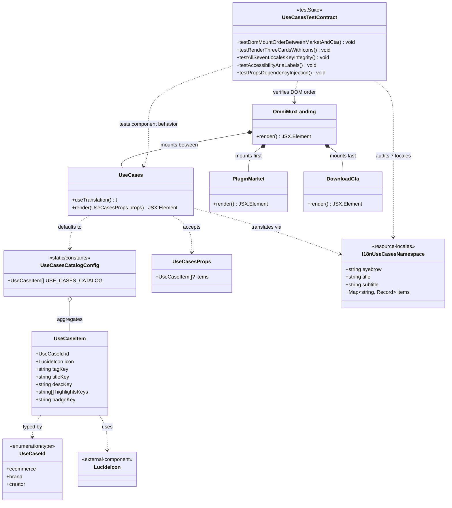
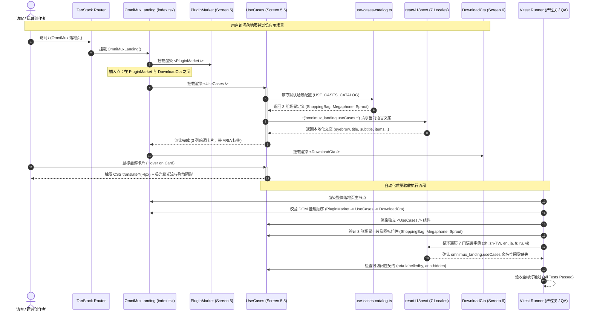
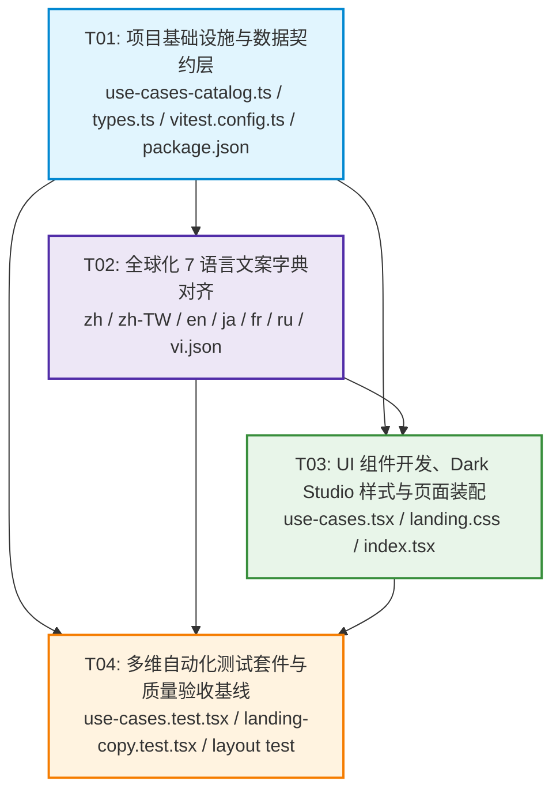

# 落地页新增「应用场景」（UseCases）模块系统架构设计与任务分解

> **文档路径**：`docs/system_design.md`  
> **架构师**：高见远（Gao）· 资深系统架构师  
> **输入需求**：许清楚（Xu）· 产品经理 《落地页新增「应用场景」模块 PRD（v1.0.0）》  
> **目标系统**：OmniMux Web 前端（`web/` 特性模块 `omnimux-landing`）  
> **实施责任人**：寇豆码（Engineer）  
> **测试责任人**：严过关（QA Engineer）  
> **版本**：v1.0.0 (Architecture & WBS Baseline)

---

# Part A: System Design（系统设计）

## 1. Implementation Approach（实现方案与架构选型）

### 1.1 需求背景与核心技术挑战

根据产品经理许清楚提供的 PRD，OmniMux 落地页需要在现有能力插件市场（`PluginMarket`，Screen 5）与底部转化区（`DownloadCta`，Screen 6）之间，插入全新的「应用场景」（`UseCases`）模块。该模块承接上游展示的 Agent 工具与技能生态，向下游的桌面客户端下载做价值具象化收敛。

核心技术挑战与应对策略如下：

1. **暗调卡片美学（Dark Studio Aesthetic）与整页调性融合**：
   - 挑战：落地页整体采用冷灰与暖白微质感（`#faf8f5` / `#ffffff`），而「应用场景」要求采用深色暗调卡片风格（Dark Studio Aesthetic），需要既突出卡片专业沉浸感，又与前后模块（浅底色的 PluginMarket 和极光紫背景的 DownloadCta）自然过渡。
   - 方案：外层容器保留页面呼吸间距，卡片采用深色暗调黑曜基底（`rgba(18, 22, 34, 0.92)` 与 `#11141d`），辅以细微的 `1px solid rgba(255, 255, 255, 0.08)` 边框；悬停时引入极光紫光流（Aurora Violet Glow：`rgba(103, 87, 231, 0.28)`）与 `-4px` 微浮动效（Y-axis float），带来高品质触感。

2. **数据配置与展示解耦（Configuration-Driven & Clean Separation）**：
   - 挑战：硬编码场景数据会导致多语言扩展困难、测试不易隔离，并且破坏组件单一职责。
   - 方案：创建独立的数据配置层 `web/src/features/omnimux-landing/lib/use-cases-catalog.ts`，定义严格的 `UseCaseItem` 数据契约，并导出 `USE_CASES_CATALOG` 静态常量；组件 `UseCases` 接收可选的 `props.items`（默认使用 `USE_CASES_CATALOG`），实现开箱即用的默认渲染与测试环境中的零副作用依赖注入。

3. **Lucide 图标组件动态契约**：
   - 挑战：3 大业务场景分别对应不同商业语义：
     - 电商带货（TikTok Shop / 跨国商家）：`ShoppingBag` 图标
     - 品牌出海（DTC 品牌 / 营销团队）：`Megaphone` 图标
     - 个人创作者（个人工作室 / 独立内容创作者）：`Sprout` 图标
   - 方案：在 `UseCaseItem` 中定义 `icon: LucideIcon`，在组件中作为 First-class React Component 渲染，并强制追加 `aria-hidden="true"` 无障碍属性，确保图标的装饰性语义规范。

4. **全球化 7 语言全量对齐（Zero i18n Regressions）**：
   - 挑战：OmniMux 全球化支持 `zh`（简中）、`zh-TW`（繁中）、`en`（英文）、`ja`（日文）、`fr`（法文）、`ru`（俄文）、`vi`（越南文）。新增模块必须全量覆盖，严禁硬编码文本与语言遗漏。
   - 方案：构建统一的国际化命名空间 `omnimux_landing.useCases.*`，结构化覆盖模块主副标题、分类标签、场景主副标题、亮点条目与成效徽章。

5. **严格的 DOM 挂载顺序与质量守护**：
   - 挑战：必须确保 `<UseCases />` 精确插入在 `<PluginMarket />` 与 `<DownloadCta />` 之间，任何顺序错位都会破坏落地页的 6 屏叙事逻辑。
   - 方案：在 `index.tsx` 的 `<main>` 中规范装配，并编写专用自动化测试 `use-cases.test.tsx`，通过 DOM 兄弟节点选择器（`previousElementSibling` / `nextElementSibling`）断言物理挂载顺序。

---

## 2. File List（完整涉及文件清单）

```
web/
├── package.json                                                        # [依赖声明] 确认 lucide-react, react-i18next 等已就绪
├── src/
│   ├── features/
│   │   └── omnimux-landing/
│   │       ├── types.ts                                                # [类型契约] 导出 UseCaseItem 与 UseCaseId 接口
│   │       ├── lib/
│   │       │   └── use-cases-catalog.ts                                # [新建/配置] 场景元数据契约与 Lucide 图标引用
│   │       ├── components/
│   │       │   ├── use-cases.tsx                                       # [新建/组件] 应用场景核心卡片栅格组件
│   │       │   └── __tests__/
│   │       │       ├── vitest.config.ts                                # [配置升级] 将 use-cases.test.tsx 加入测试包含列表
│   │       │       ├── use-cases.test.tsx                              # [新建/单测] DOM顺序、3卡片渲染、7语言完整性与ARIA测试
│   │       │       ├── landing-copy.test.tsx                           # [修改/回归] 集成级 i18n 字典断言增加 useCases 校验
│   │       │       └── plugin-market-layout.test.ts                    # [校验/回归] 确保前后兄弟节点布局不受影响
│   │       ├── index.tsx                                               # [装配入口] 在 PluginMarket 与 DownloadCta 之间挂载
│   │       └── landing.css                                             # [样式契约] 新增 .omx-use-cases 体系与响应式 Dark Studio 风格
│   └── i18n/
│       └── locales/
│           ├── zh.json                                                 # [语言字典] 简体中文 omnimux_landing.useCases.*
│           ├── zh-TW.json                                              # [语言字典] 繁体中文 omnimux_landing.useCases.*
│           ├── en.json                                                 # [语言字典] 权威英文 omnimux_landing.useCases.*
│           ├── ja.json                                                 # [语言字典] 日语字典 omnimux_landing.useCases.*
│           ├── fr.json                                                 # [语言字典] 法语字典 omnimux_landing.useCases.*
│           ├── ru.json                                                 # [语言字典] 俄语字典 omnimux_landing.useCases.*
│           └── vi.json                                                 # [语言字典] 越南语字典 omnimux_landing.useCases.*
docs/
├── system_design.md                                                    # [架构文档] 本系统架构设计与 WBS 分解
├── class-diagram.mermaid                                               # [架构图] 类结构与数据契约 Mermaid 图
└── sequence-diagram.mermaid                                            # [时序图] 页面调用与测试验收 Mermaid 图
```

---

## 3. Data Structures and Interfaces（数据结构与接口契约）

### 3.1 类型契约定义（TypeScript）

```typescript
import type { LucideIcon } from 'lucide-react'

export type UseCaseId = 'ecommerce' | 'brand' | 'creator'

export interface UseCaseItem {
  /** 唯一场景标识 */
  id: UseCaseId
  /** Lucide 图标组件引用 (ShoppingBag / Megaphone / Sprout) */
  icon: LucideIcon
  /** 受众/定位小标签 i18n 键 */
  tagKey: string
  /** 场景主标题 i18n 键 */
  titleKey: string
  /** 场景核心痛点/解法描述 i18n 键 */
  descKey: string
  /** 场景亮点要点列表 (通常为 3 项) i18n 键数组 */
  highlightsKeys: string[]
  /** 场景效能或成效徽章 i18n 键 (例如 ROI +300% / 10x 产能) */
  badgeKey?: string
}

export interface UseCasesProps {
  /** 支持测试注入的场景数据源，缺省使用 USE_CASES_CATALOG */
  items?: UseCaseItem[]
}
```

### 3.2 架构类图与关联关系



---

## 4. Program Call Flow（程序调用流程）

模块运行与测试验证的时序流程详见 `docs/sequence-diagram.mermaid`。



---

## 5. Anything UNCLEAR（待确认事项与设计假设）

1. **场景卡片点击跳转行为**：
   - 假设：当前阶段 3 张场景卡片作为信息展示层与价值背书层，不承载外部跳出链接或二级路由跳转，核心引导目标是让用户顺畅滑动到底部的 `<DownloadCta />`。卡片整体提供可访问聚焦状态与优雅的 hover 微浮动效。
2. **极光紫光流渲染性能**：
   - 假设：为保证 60fps / 120fps 高刷屏性能，光流效果使用纯 CSS 径向渐变 `radial-gradient` 与 `box-shadow` 硬件加速过渡，避免在滚动路径上使用高负载的 JS Canvas 计算。
3. **移动端折叠与排列策略**：
   - 假设：在桌面端（`min-width: 1024px`）为 3 列并排平铺；平板端（`768px ~ 1023px`）保持 3 列紧凑或自适应平铺；移动端（`< 768px`）自动降级为纵向堆叠，并维持各卡片间 16px 留白。

---

# Part B: Task Decomposition（任务分解 WBS）

## 6. Required Packages（依赖声明）

本项目严格复用工程现有依赖，无需引入任何额外第三方包：
- `lucide-react@^1.23.0`：提供 `ShoppingBag`、`Megaphone`、`Sprout` 矢量图标
- `react-i18next@^15.4.1` / `i18next@^26.3.4`：多语言国际化响应式绑定
- `@testing-library/react@^16.3.2` & `vitest@^4.1.0`：单元测试与组件挂载断言

---

## 7. Task List（严格遵循：任务总数 ≤ 5，每任务 ≥ 3 文件）

| 任务 ID | 任务名称 | 责任人 | 涉及源文件（≥ 3 个） | 前置依赖 | 优先级 |
| :--- | :--- | :--- | :--- | :--- | :--- |
| **T01** | **项目基础设施与数据契约层** | 寇豆码 (Dev)<br>高见远 (Arch) | 1. `web/src/features/omnimux-landing/lib/use-cases-catalog.ts`<br>2. `web/src/features/omnimux-landing/types.ts`<br>3. `web/src/features/omnimux-landing/components/__tests__/vitest.config.ts`<br>4. `web/package.json` | 无 | **P0** |
| **T02** | **全球化 7 语言文案字典对齐** | 寇豆码 (Dev)<br>许清楚 (PM) | 1. `web/src/i18n/locales/zh.json`<br>2. `web/src/i18n/locales/zh-TW.json`<br>3. `web/src/i18n/locales/en.json`<br>4. `web/src/i18n/locales/ja.json`<br>5. `web/src/i18n/locales/fr.json`<br>6. `web/src/i18n/locales/ru.json`<br>7. `web/src/i18n/locales/vi.json` | T01 | **P0** |
| **T03** | **UI 组件开发、Dark Studio 样式契约与落地页装配** | 寇豆码 (Dev)<br>高见远 (Arch) | 1. `web/src/features/omnimux-landing/components/use-cases.tsx`<br>2. `web/src/features/omnimux-landing/landing.css`<br>3. `web/src/features/omnimux-landing/index.tsx` | T01, T02 | **P0** |
| **T04** | **多维自动化测试套件与质量验收基线** | 严过关 (QA)<br>寇豆码 (Dev) | 1. `web/src/features/omnimux-landing/components/__tests__/use-cases.test.tsx`<br>2. `web/src/features/omnimux-landing/components/__tests__/landing-copy.test.tsx`<br>3. `web/src/features/omnimux-landing/components/__tests__/plugin-market-layout.test.ts` | T01, T02, T03 | **P0** |

### 任务详细执行规格：

#### T01：项目基础设施与数据契约层
- **目标**：建立统一的数据契约、常量配置与测试运行环境，为业务开发铺平通道。
- **实施细节**：
  1. 在 `types.ts` 中定义 `UseCaseId` 与 `UseCaseItem`，明确图标、标题键、描述键、亮点项键及徽章键。
  2. 在 `lib/use-cases-catalog.ts` 中实例化 `USE_CASES_CATALOG` 数组：
     - `ecommerce`：绑定 `ShoppingBag` 图标组件
     - `brand`：绑定 `Megaphone` 图标组件
     - `creator`：绑定 `Sprout` 图标组件
  3. 在 `vitest.config.ts` 的 `include` 列表中加入 `'src/features/omnimux-landing/components/__tests__/use-cases.test.tsx'`。
  4. 检查 `package.json` 依赖完整性，执行类型推导验证。

#### T02：全球化 7 语言文案字典对齐
- **目标**：在 7 国语言字典中全量补充 `omnimux_landing.useCases.*` 键树，杜绝页面乱码或缺失。
- **实施细节**：
  1. 对齐结构：
     - `omnimux_landing.useCases.eyebrow`
     - `omnimux_landing.useCases.title`
     - `omnimux_landing.useCases.subtitle`
     - `omnimux_landing.useCases.items.<id>.tag`
     - `omnimux_landing.useCases.items.<id>.title`
     - `omnimux_landing.useCases.items.<id>.desc`
     - `omnimux_landing.useCases.items.<id>.h1` / `.h2` / `.h3`
     - `omnimux_landing.useCases.items.<id>.badge`
  2. 7 语言文案全量落地：确保简中、繁中、英文、日文、法文、俄文、越南文字典无语法破损、无缺失键。

#### T03：UI 组件开发、Dark Studio 样式契约与落地页装配
- **目标**：实现高保真 Dark Studio Aesthetic 卡片组件，并在落地页正确位置装配。
- **实施细节**：
  1. 创建 `components/use-cases.tsx`：
     - 遵循 `web/AGENTS.md`：Props 不解构（`props.items ?? USE_CASES_CATALOG`），使用 `const { t } = useTranslation()`。
     - 语义化 HTML：`<section className="omx-use-cases" id="useCases" aria-labelledby="useCasesTitle">`。
     - 循环渲染 3 张卡片，图标注入 `aria-hidden="true"`。
  2. 在 `landing.css` 中追加 `.omx-use-cases` 样式：
     - 网格系统：桌面端 `grid-template-columns: repeat(3, 1fr)`；移动端（`max-width: 768px`）`grid-template-columns: 1fr`。
     - 卡片深色基底：`background: #11141d`，边框 `1px solid rgba(255, 255, 255, 0.08)`，圆角 `20px`。
     - 交互微浮与极光紫流：悬停 `transform: translateY(-4px)`，`box-shadow: 0 16px 36px -8px rgba(0, 0, 0, 0.5), 0 0 24px -4px rgba(103, 87, 231, 0.28)`。
  3. 在 `index.tsx` 的 `<main>` 中，在 `<PluginMarket />` 与 `<DownloadCta />` 之间准确插入 `<UseCases />`。

#### T04：多维自动化测试套件与质量验收基线
- **目标**：建立坚固的防退化测试防护网，覆盖挂载顺序、组件行为、国际化与无障碍。
- **实施细节**：
  1. 新增 `components/__tests__/use-cases.test.tsx`：
     - 断言 DOM 挂载顺序：`pluginMarket.nextElementSibling === useCases`，`useCases.nextElementSibling === downloadCta`。
     - 断言 3 张卡片全量渲染，ShoppingBag、Megaphone、Sprout 三个图标组件成功挂载。
     - 遍历 7 语言字典，验证 `omnimux_landing.useCases` 下所有叶子键非空。
     - 检查无障碍 ARIA 属性（`aria-labelledby`，`aria-hidden` 等）。
  2. 在 `landing-copy.test.tsx` 中扩充对 UseCases 模块的多语言断言。
  3. 执行 `bun run test`、`bun run build:check` 与 `bun run lint`，确保质量门禁全绿。

---

## 8. Shared Knowledge（团队共享知识与开发契约）

1. **样式与类名命名空间规范**：
   - 严格遵循 BEM 命名法，所有新类名前缀必须为 `.omx-use-cases*`：
     - 根容器：`.omx-use-cases`
     - 主容器限制宽度：`.omx-use-cases__container`（`max-width: 1440px; padding-inline: 20px / 60px`）
     - 头部：`.omx-use-cases__header`、`.omx-use-cases__eyebrow`、`.omx-use-cases__title`、`.omx-use-cases__subtitle`
     - 网格：`.omx-use-cases__grid`
     - 卡片：`.omx-use-cases__card`、`.omx-use-cases__icon-wrap`、`.omx-use-cases__tag`、`.omx-use-cases__card-title`、`.omx-use-cases__card-desc`、`.omx-use-cases__highlights`、`.omx-use-cases__highlight-item`、`.omx-use-cases__badge`
2. **React 19 & Props 使用准则**：
   - 严格遵循 `web/AGENTS.md`：组件 props 禁止无意义解构，直接使用 `props.items`；函数内统一使用 `const { t } = useTranslation()`。
3. **无障碍设计（A11y）契约**：
   - 外层 Section 必须具备 `aria-labelledby="useCasesTitle"`，主标题设置 `id="useCasesTitle"`。
   - 所有装饰性 Lucide 图标必须标注 `aria-hidden="true"`。
   - 亮点列表使用无序列表 `<ul>` 与 `<li>` 实现语义化标注。
4. **测试运行准则**：
   - 运行针对性测试：`bun run test src/features/omnimux-landing/components/__tests__/use-cases.test.tsx`。
   - 避免脆弱断言：不测私有内部 state，通过用户可见的角色（role）、文字与稳定属性进行断言。

---

## 9. Task Dependency Graph（任务依赖拓扑图）



---

# Part C: Verification Baseline（验收指令基线）

供执行工程师寇豆码（Engineer）与测试工程师严过关（QA）执行的标准验证命令序列：

```bash
# 1. 针对性单元测试验证（挂载顺序、卡片渲染、7语言完整性、ARIA）
cd web && bun test src/features/omnimux-landing/components/__tests__/use-cases.test.tsx

# 2. 落地页整体测试集回归验证
cd web && bun test src/features/omnimux-landing/components/__tests__/landing-copy.test.tsx

# 3. 静态类型检查与生产构建校验
cd web && bun run build:check

# 4. 代码风格与 Lint 规范扫描
cd web && bun run lint
```
